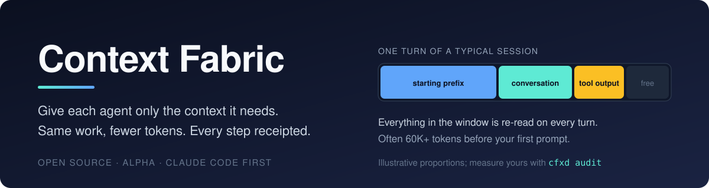
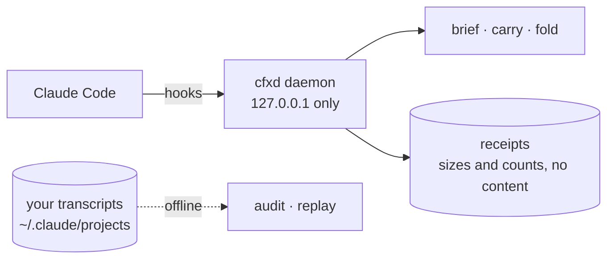

<div align="center">



**A token-accounting and context-control plugin for Claude Code.**<br>
Measures what a session really spends, briefs sub-agents, carries state across `/compact`,<br>
and keeps a content-free receipt of every decision it makes.

[](https://github.com/Pranavk098/context-fabric/actions/workflows/ci.yml)
[](https://github.com/Pranavk098/context-fabric/actions/workflows/plugin.yml)


</div>

---

## Why

Tokens are the unit of cost *and* of context. In an agent session the same window (system prompt, skill and tool
listings, history, tool output) is **re-sent and re-read on every turn**, so cost grows with *turns × context size*.
Almost nobody can see what is in that window or what each part costs.

Context Fabric makes it visible first, and then tests, with real numbers, which tricks actually shrink it.

## What it does today

| Part | What it does | State |
| :--- | :--- | :--- |
| **`cfxd audit`** | Offline, counts-only breakdown of your own Claude Code transcripts: starting prefix, tool results, repeated reads, sub-agents, compactions | working |
| **`cfxd replay`** | What-if simulator: how much could shrinking old tool output have saved, cache effects included | working |
| **Brief** | Hands a sub-agent the files and saved outputs the parent already touched (facts only, never tool text) | experimental |
| **Carry** | Snapshots the working set before `/compact` and restores it afterwards | experimental |
| **Fold** | Replaces very large tool output with a short note plus a pointer to the full copy | built, **off by default** |
| **`cfxd stats` · `doctor`** | Per-session numbers and a health check, including daemon identity | working |

## How it works



The plugin is a thin hook layer over a resident local daemon. It **fails open** (any error and Claude Code carries on
as if it were not installed), makes **no network calls**, and writes only **sizes, counts and hashes** to its logs.

## Try it

```text
/plugin marketplace add Pranavk098/context-fabric
/plugin install context-fabric@context-fabric
```

Needs [`uv`](https://docs.astral.sh/uv/) and, on Windows, Git for Windows. Full steps and what is stored on disk:
[`docs/INSTALL-ALPHA.md`](docs/INSTALL-ALPHA.md). **Use it on your own computer only** for now.

No plugin needed to look at your own data. This reads your local Claude Code transcripts and prints counts and
sizes only (nothing leaves your machine):

```bash
uvx --from git+https://github.com/Pranavk098/context-fabric cfxd audit
```

## What we have measured, including the losses

We publish negative results because they are the point. All exploratory (small *n*, one developer's machine):

| Finding | Result | What we did |
| :--- | :--- | :--- |
| Folding `Read` output | **+101% tokens** on read-everything tasks (the model re-read the saved file) | turned off |
| Folding long command output | no measurable saving; Claude Code already shortens huge output itself | turned off |
| Shrinking old tool results (183 real sessions) | **at most about 7%** weighted cost, optimistic upper bound | not building a proxy for it |
| Starting prefix | median **62K tokens** in context before the first prompt, re-read every turn | next target |
| Brief, Carry | work end to end; token savings **not yet measured** | measuring |

## Where this is going

A direction, not a promise list:

- **Measure** — a public, offline yardstick any developer can run on their own transcripts.
- **Trim the fixed cost** — find the skills, connectors and instructions that cost tokens every turn and are never used.
- **Coordinate** — sub-agent briefs and compaction carry, each kept only if paired runs show it pays.
- **Prove** — a pre-registered paired benchmark: cache-weighted cost, raw data published, losses included.
- **More clients** — OpenCode and Codex after Claude Code.

## Principles

**Fail open** · **local only** · **nothing deleted** (anything shortened keeps a full copy on disk) ·
**receipts, not logs of your code** · **numbers carry their evidence level** (anecdote, exploratory, confirmatory).

## Help wanted

Install it, use it for a few sessions, then open an
[**alpha feedback** issue](https://github.com/Pranavk098/context-fabric/issues/new?template=alpha-feedback.md) with the
output of `cfxd audit` and `cfxd stats` (counts only) and whether anything broke or felt slower. Security reports:
[`SECURITY.md`](SECURITY.md).

## Earlier work and docs

The repo also holds the first-generation research: a deterministic context compiler and an OpenAI-compatible
sidecar (`cfx serve`) with pre-registered results on local models, including several that failed. Start at
[`docs/README.md`](docs/README.md); results are indexed in
[`docs/engineering/NUMBERS.md`](docs/engineering/NUMBERS.md). Architecture decisions:
[`docs/decisions/`](docs/decisions/).

MIT licensed — see [`LICENSE`](LICENSE).
