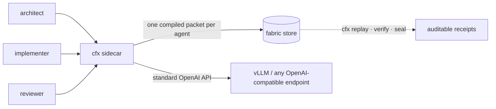

<div align="center">

# Context Fabric

**Your agents keep re-reading everything. Compile it once — and seal the receipt.**

One shared memory. One small, cache-aligned packet per agent.
Every hand-off hashed, signable, and replayable.

[](https://github.com/Pranavk098/context-fabric/actions/workflows/ci.yml)


</div>

---

The context window is an L1 cache. Everything else is memory management.
Context Fabric is the missing MMU: it compiles shared project state into bounded,
prefix-cache-aligned packets — one per agent — and proves exactly what each agent received.



Six agents working the same project should not each pay for the whole history.
Point any OpenAI-compatible tool at `cfx serve`, and they stop re-ingesting a full
shared dump each turn — a billed-token win when the context outgrows a shared prefix
cache; on a warm cache that fits, raw sharing wins on prefill (receipts below).

## The receipt

Real run — local RTX 5070, Qwen2.5-1.5B, temp 0, six agents, 26-block fixture (~6.7k tokens):

```text
$ cfx demo --scenario fleet

arm          prompt tok   per req   accuracy   wall     kv peak
------------------------------------------------------------------
broadcast        44,854     7,476       6/6     2.80 s    0.061
compile          14,170     2,362       6/6     2.08 s    0.020
------------------------------------------------------------------
saved 30,684 tokens (3.17x) at identical accuracy
receipt -> evals/reports/demo_fleet_20261017_231929.json
```

`broadcast` is the *strongest* naive baseline — every agent gets the entire raw state,
identical every time, so the GPU's prefix cache helps it as much as possible.
We still win by 3.17x on prompt tokens, at equal accuracy.

Pre-registered pilot on the real `httpx` repository (32k-token contexts, memory built
mechanically from the source): **13.62× fewer billed prompt tokens at parity (5/6 vs 5/6)** —
[`PILOT-MECH-RESULT.md`](docs/engineering/PILOT-MECH-RESULT.md). On a warm prefix cache the raw
prompt costs only 182 uncached tokens vs 11,857 for compile, so the win is context size and KV
memory, not prefill.

## Numbers with receipts

> **Every figure ships with its baseline, its caveat, and its artifact.**
> An adversarial verification agent recomputes the claims from raw data before they land here
> (`docs/engineering/*-REVIEW.md`). Where the evidence is weak, the number says so.

| What | Result | Baseline & caveat | Receipt |
| :--- | :--- | :--- | :--- |
| **Real-repo pilot** | **13.62× fewer billed prompt tokens**, accuracy parity (5/6 vs 5/6) | real `httpx` @ `b5addb64`, 32k-token contexts, mechanical memory, one 1.5B model; uncached tokens 182 raw vs 11,857 compile on a warm cache. The earlier 35.87× used hand-written answer-carrying blocks | [`PILOT-MECH-RESULT.md`](docs/engineering/PILOT-MECH-RESULT.md) |
| Multi-agent demo | **3.17× fewer prompt tokens**, same answers (6/6 both) | vs strongest naive broadcast; warm cache; synthetic fixture | [`DEMO.md`](docs/engineering/DEMO.md) |
| Engine portability | **Ollama reproduces vLLM exactly** (16/16 byte-identical prompts, 3.17× holds) | no cache/KV telemetry on Ollama; Q4 vs fp16 | [`ENGINE-MATRIX.md`](docs/engineering/ENGINE-MATRIX.md) |
| Cross-agent cost (Stage B) | **~2× best-case / ~9× realistic** | vs naive broadcast on one GPU | [`VERIFICATION-REPORT.md`](docs/engineering/VERIFICATION-REPORT.md) |
| 16 concurrent agents | **8.23× throughput** (43.25 vs 5.26 req/s) · **20.2× lower KV peak** | KV vs *unshared* raw (~2× vs shared raw prefix) | [`stage_b5` artifact](evals/reports/stage_b5_20261017_124856.json) |
| Cold boot | **348 vs 3,146 tokens · 100% vs 25%** | n=4×3, one 1.5B model — narrow probe | [`RERUN-REVIEW.md`](docs/engineering/RERUN-REVIEW.md) |
| Real-code compression | **~17×** on `httpx` · 100% quality at ~5.6× | extractive & deterministic — no LLM summarizer, by design | [`ENGINEERING-LOG.md`](docs/engineering/ENGINEERING-LOG.md) |
| Recall | BM25 top-1 **0.00 → 0.85** vs old baseline | synthetic set; hybrid does not beat embeddings-only there | [`RECALL-BENCH.md`](docs/engineering/RECALL-BENCH.md) |
| Packing | **−13.4% redundancy** vs greedy | coverage trade-off 5/6 vs 6/6 — stated, not hidden | [`PACKING-QUALITY.md`](docs/engineering/PACKING-QUALITY.md) |
| Negative knowledge | 3B metrics trap **4/4 → 0/4 bad** | 1.5B: null. Directional only — n tiny, prompt-perturbation confound | [`DEMO.md`](docs/engineering/DEMO.md) |

## What it does — five verbs

- **Compile** — a deterministic 9-stage compiler (policy → BM25/hybrid recall → λ-MMR packing →
  closure → 4-tier budget) turns shared state into a bounded packet. Same inputs, byte-identical
  packet: frozen `CPP v1.0` schema, RFC 8785 hashing, Ed25519 signatures.
- **Plug** — `cfx serve` in front of any OpenAI-compatible endpoint. Zero code changes: point
  your tool's base URL at it. `passthrough` mode exists so you can run honest A/B yourself.
  Cloud APIs get provider-shaped requests with correct cache hints (`adapters/`).
- **Share** — agents share Tier 0/1 memory through prefix sharing; sub-agents mount the same
  prefix at the head of every packet. New writes land **quarantined** until trusted.
- **Seal** — every packet is hashed and can be signed; epochs chain with Merkle inclusion proofs.
  `cfx verify` tells you if one character changed.
- **Replay** — `cfx replay` recompiles a past hand-off from its recorded manifest and proves
  byte-equality — or reports drift. This proves the *notes*, never the model's answer.

## Quickstart

```bash
uv sync --extra dev
uv run python -m evals.spike_deterministic   # zero-GPU deterministic-core check
uv run pytest -q                             # 338 tests (3 skip without the embeddings extra)
uv run cfx repro                             # recompute every offline claim from its artifact

# The plug, in front of your local model server
uv run cfx serve --upstream http://127.0.0.1:8000 --fabric fabric.db
uv run cfx demo --scenario fleet             # before/after receipt, one command
uv run cfx demo --repo .                     # run the receipt on your own repo
uv run cfx add --store fabric.db --file block.json --trusted
uv run cfx mcp --store fabric.db             # MCP tools: search / verify / add
uv run cfx replay --store fabric.db --packet-id <cpk_...>
uv run cfx seal --store fabric.db --private-key <hex> --out epochs.json
```

Setup takes minutes — see [`SIDECAR.md`](docs/engineering/SIDECAR.md) (10-minute setup) and
[`RUNTIME.md`](docs/engineering/RUNTIME.md) (GPU/WSL notes). Point any OpenAI-compatible client
(Cursor, LangChain, scripts, anything) at `http://127.0.0.1:8080/v1`.

## What it is not — yet

Honesty is the product, so the gaps are on the label:

- **Not a hosted service.** Local-first by design; SQLite store, no cloud dependency.
- **No LLM in the compile path.** Summaries would be nondeterministic; we refuse them in v0.
- **Engine cache hints are computed but not yet sent** — vLLM RFC #52113 is still open.
- **Per-role compiling does not beat prefix caching when the context fits.** Pre-registered B4
  (httpx, 1.5B model, 4 roles): compiled packets lost on quality (21/36 vs 29/36) *and* on
  uncached prefill tokens to one shared, prefix-cached raw prompt
  ([`B4-RESULT.md`](docs/engineering/B4-RESULT.md)).
- **When the repo does not fit, compiling is cheapest but not most accurate.** Pre-registered
  B4 v3 (full httpx vs a 16k window, 1.5B and 0.5B models): compile used the fewest billed and
  uncached tokens and the least KV, but plain BM25 retrieval at the same budget answered more
  questions ([`B4-V3-RESULT.md`](docs/engineering/B4-V3-RESULT.md)).
- **Postgres, multi-worker serving, OTel** are deferred with explicit triggers
  ([`ROADMAP-DECISIONS.md`](docs/engineering/ROADMAP-DECISIONS.md)); the full spec-vs-code map is
  [`IMPLEMENTATION-STATUS.md`](docs/engineering/IMPLEMENTATION-STATUS.md).

## Repository map

```
protocol/   CPP v1.0 frozen schemas · RFC 8785 canonicalization · Ed25519 · epoch chain + Merkle proofs
kernel/     9-stage context compiler · .cfx cartridge · BM25/hybrid recall · λ-MMR packer · CoW epochs · SQLite store
sidecar/    cfx CLI + OpenAI-compatible proxy · writable quarantined memory · MCP server · replay/seal · demo
evals/      telemetry harness + every Stage-B experiment that produced a number in this README
tests/      338 tests (deterministic core, verifiers, replay, MCP, perf budget)
scripts/    WSL/GPU bring-up and runners
docs/       the full record — see the index below
```

**Reproduce it yourself:** [`REPRODUCE.md`](docs/engineering/REPRODUCE.md) — one offline command
(`cfx repro`) recomputes every stored number, and the GPU/model runs that need a live engine are
listed separately, never claimed as reproduced.

**Documentation:** start at [`docs/README.md`](docs/README.md). The interesting parts:
[`Arch-Spec.md`](docs/design/Arch-Spec.md) (normative design),
[`ENGINEERING-LOG.md`](docs/engineering/ENGINEERING-LOG.md) (every measured result),
[`AUDIT.md`](docs/engineering/AUDIT.md) (shortfall ledger), and the prior-art studies in
[`docs/research/`](docs/research/) — including the post-mortems that shaped this plan.

## License

MIT — see [`LICENSE`](LICENSE).
