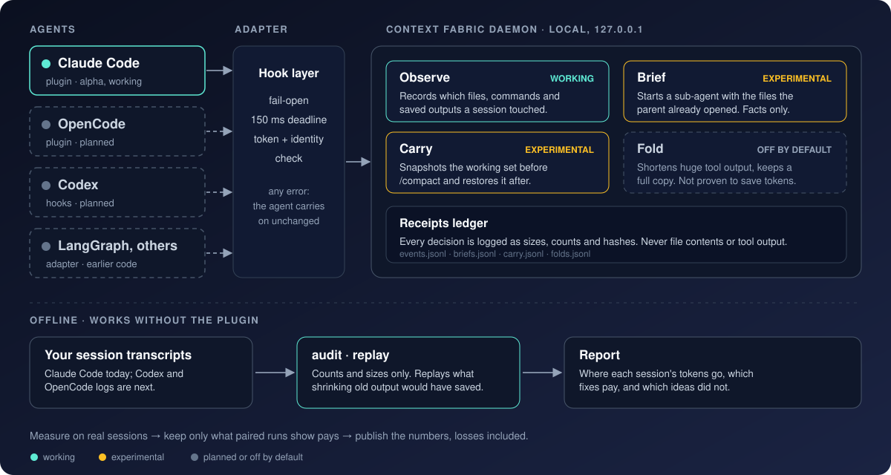
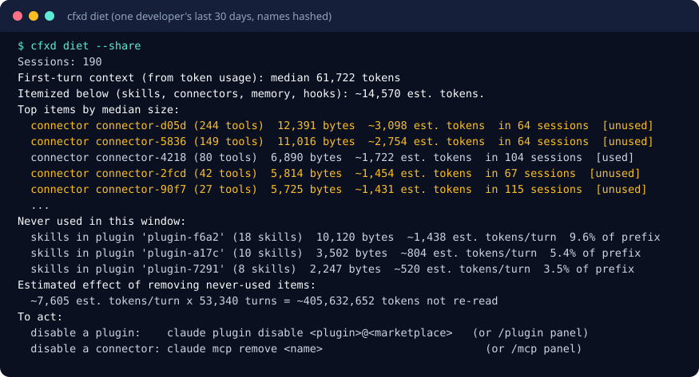

<div align="center">


[](https://github.com/Pranavk098/context-fabric/actions/workflows/ci.yml)
[](https://github.com/Pranavk098/context-fabric/actions/workflows/plugin.yml)


[](https://m8ven.ai/mcp/pranavk098-context-fabric-zq90jg?s=readme)

</div>

Context Fabric measures where a coding agent's context and tokens go, from your own session transcripts, and is
building tools that keep long sessions lean. It is a Claude Code plugin plus offline command-line tools; Codex and
OpenCode logs can be measured too.

**Objective:** keep the context a coding agent re-reads on every turn as small as the work allows, and show every
effect as a receipt you can re-run on your own data, so a saving is checked rather than believed.

**Status:** alpha, Claude Code first. The measurement tools work. The mechanisms that act on context (brief, carry)
are experimental and have no measured token effect yet; fold is off. **No saving is proven.** The paired benchmark that can show one (short, medium and long sessions) is pre-registered; the full run has not been done.
[Evidence](#evidence-so-far) lists what we measured, including what did not work.

## Principles

- **Fail open.** Every handler has a 150 ms deadline. A timeout, an exception or a malformed payload returns an empty
  response and the agent continues exactly as if the plugin were not installed.
- **Local only.** The daemon binds `127.0.0.1` and makes no network calls. There is no telemetry.
- **Content-free receipts.** Logs hold event names, sizes, counts, hashes and latencies. File contents, prompts and
  tool output are never written to them.
- **Observed facts only.** Briefs and carry notes list paths, line counts and saved-output ids that the daemon saw.
  Tool output is never copied into a prompt, so injected text cannot be amplified.
- **Reversible.** Anything shortened keeps a byte-exact copy on disk and states where it is.
- **Deterministic.** Handlers make no model calls: the same input produces the same output.
- **Evidence before defaults.** Every number carries an evidence level (anecdote, exploratory, confirmatory). A
  feature is on by default only while measurements support it; folding was switched off when they did not.

## Why

In an agent session, cost grows with *turns × context size*, because the whole window is re-read on every turn. Four
sources of waste are visible in real transcripts:

- **Starting prefix.** The window opens with Claude Code's own system prompt and tool definitions, plus your skill
  and tool listings, connector instructions, memory and hook output. On the machine we measured, the median first-turn
  context was 62K tokens, of which about 14K came from the user's own setup.
- **Long sessions.** On the machine we measured, sessions of 40+ turns carried 95% of the cost, because the whole
  window is re-read on every turn.
- **Cold-start sub-agents.** A sub-agent begins with nothing, or with a copy of everything.
- **State lost at `/compact`.** After compaction the agent re-discovers which files and outputs it was working with.
- **Oversized tool output.** One large result stays in the window for every later turn.

Most developers cannot see any of this. Context Fabric shows it per session; the tools that act on it stay
experimental until a paired test shows they pay.

## How it works



1. The agent's hooks call a small launcher. It starts the daemon on the first session and forwards each event.
2. The daemon records what the session touched, builds a brief or a carry note when the event calls for one, and
   writes a receipt.
3. Offline, `audit` and `replay` read your own transcripts and report where tokens go and what shrinking would have
   saved. They work without the plugin installed.

## What it does today

| Part | What it does | State |
| :--- | :--- | :--- |
| `cfxd audit` | Counts-only breakdown of your transcripts: starting prefix by item, tool results, repeated reads, sub-agents, compactions | working |
| `cfxd coverage` | Compares transcript tool calls with the PostToolUse events the helper logged, reporting hook delivery rates; counts only | experimental |
| `cfxd diet` | Lists your starting-prefix items (skills, connectors, memory, hooks), which you never used in 30 days, and what each costs every turn | working |
| `cfxd waste` | Measures how much cost sits in loops, retry streaks, the most expensive sessions and repeated discovery | working |
| `cfxd routing` | Splits your sessions' tokens and API-equivalent dollars by model and by main conversation versus sub-agents, and shows what a cheaper sub-agent tier would change (price only, quality unmeasured) | working |
| `cfxd agent-audit` | The same counts-only breakdown for Codex and OpenCode session logs | working |
| `cfxd replay` | Simulates shrinking old tool output on your sessions, with prompt-cache effects, and reports the bound | working |
| `cfxd tour` | A guided five-step first run over your own transcripts | working |
| `cfxd week --share` | A one-command weekly summary of counts that is safe to paste | working |
| `cfxd trend` | Week-over-week snapshots from `cfxd week --save`, each change labelled OBSERVED (a before/after, not a counterfactual) | experimental |
| `cfxd brief` | Lists each sub-agent handoff Brief logged: target model, packet size, why items were chosen, what the child re-read anyway. Needs `cfxd set brief_v1 on`; experimental | experimental |
| `cfxd ledger` | What the plugin did or changed, each line labelled OBSERVED, ESTIMATED or PROVEN (none proven yet) | experimental |
| `cfxd refetch` | Measures how much of the context dropped by a compaction or `/clear` the agent reads again | working |
| `cfxd diet --apply` / `--undo` | Disables fully unused local plugins through Claude Code's own command, with an exact undo | experimental |
| Checkpoint (`/context-fabric:checkpoint`, `cfxd checkpoint show`, then `/clear`) | Saves a short note of files, commands, todos and an optional goal, and restores it once in the next session | experimental |
| `cfxd packet validate` | Checks a saved packet against the DRAFT v0 schema and conformance rules: shape, caps, 3,000-byte render, provenance, masking, control characters, and staleness with `--cwd` | experimental |
| `cfxd packet build --agent claude\|codex\|opencode` | Builds a v0 packet from a session log using observed tool calls only: files read or edited, masked commands, todos, last test run; records the agent and tool mapping in `source` | experimental, tested on logs only |
| `cfxd checkpoint import FILE` | Validates a packet, rewrites its cwd and arms it, so the next `/clear` in Claude Code restores it like a native checkpoint; refuses packets older than 24 hours without `--force` | experimental |
| `cfxd packet render` / `install-agents-md` | Prints a packet as a compact block (at most 3,000 bytes), or writes/removes only its marked block in `AGENTS.md`; Codex and OpenCode both read `AGENTS.md` | experimental, tested on logs only |
| Bound (`cfxd set bound on`) | Keeps only the last 150 lines of simple test and log commands | experimental, off by default |
| Coach, idle notice (`cfxd set coach on`, `idle_notice on`) | One plain line when a session gets long, or when a resume finds the cache expired | experimental, off by default |
| Brief | Gives a sub-agent the files and saved outputs the parent already touched; fires only when a sub-agent runs | experimental |
| Carry | Snapshots the working set before `/compact`, restores it after; acts only at a compaction, which is rare | experimental |
| Fold | Replaces very large tool output with a short note plus a pointer to the full copy | off by default |
| `cfxd stats`, `doctor` | Per-session numbers and a health check, including daemon identity | working |



Real output of `cfxd diet --share` on one developer's last 30 days, with skill, plugin and connector names replaced by
numbered labels. Without `--share` it prints the real names, for your own screen only.

## Try it

You need Claude Code, [uv](https://docs.astral.sh/uv/), and on Windows [Git for Windows](https://git-scm.com/download/win).
Run the commands for your system once.

**macOS / Linux** (terminal)

```bash
curl -LsSf https://astral.sh/uv/install.sh | sh        # uv
uv python install 3.12                                  # avoids a Python download inside a hook
curl -fsSL https://claude.ai/install.sh | bash          # Claude Code, if not installed
```

**Windows** (PowerShell)

```powershell
powershell -ExecutionPolicy ByPass -c "irm https://astral.sh/uv/install.ps1 | iex"   # uv
winget install --id Git.Git -e                                                        # Git for Windows, if missing
uv python install 3.12
irm https://claude.ai/install.ps1 | iex                                               # Claude Code, if not installed
```

Open a new terminal, then add the plugin. Both forms do the same thing:

```text
# inside Claude Code (CLI, VS Code panel, or the Code tab of the desktop app)
/plugin marketplace add Pranavk098/context-fabric
/plugin install context-fabric@context-fabric
```

```bash
# or from any terminal
claude plugin marketplace add Pranavk098/context-fabric
claude plugin install context-fabric@context-fabric
```

Restart Claude Code and work as usual. Check it, from any terminal:

```bash
uvx --from git+https://github.com/Pranavk098/context-fabric cfxd doctor     # expect: healthy, identity: verified
uvx --from git+https://github.com/Pranavk098/context-fabric cfxd stats
```

**Where it runs.** The CLI and the VS Code extension (`/plugins`) are supported; the desktop app's Code tab works for
local sessions (**+ → Add plugins**). Hook execution in the desktop app and VS Code is not yet verified by us; the CLI
is the tested path. Cloud sessions on claude.ai/code do not load plugins.

**No install needed to see your own data.** This reads your local Claude Code transcripts and prints counts and sizes
only; nothing leaves your machine:

```bash
uvx --from git+https://github.com/Pranavk098/context-fabric cfxd audit
```

**Help test it.** Follow [`docs/TESTING-GUIDE.md`](docs/TESTING-GUIDE.md) (about 15 minutes of setup, then normal
use), then open an
[alpha feedback issue](https://github.com/Pranavk098/context-fabric/issues/new?template=alpha-feedback.md) with the
output of `audit` and `stats`. Use it on your own computer only for now; see [`SECURITY.md`](SECURITY.md).

Remove it: `claude plugin uninstall context-fabric@context-fabric`. Full steps and what is stored on disk:
[`docs/INSTALL-ALPHA.md`](docs/INSTALL-ALPHA.md).

## Evidence so far

All results are exploratory: small *n*, one developer's machine. Raw numbers are in
[`evals/reports/plugin_alpha_20261024/`](evals/reports/plugin_alpha_20261024/exploratory_results.json) and registered
in [`docs/engineering/NUMBERS.md`](docs/engineering/NUMBERS.md).

| Finding | Result | Action |
| :--- | :--- | :--- |
| Folding `Read` output | **+101%** tokens on tasks that read whole files; the model re-read the saved copy | off by default |
| Folding long command output | No measurable saving; Claude Code already shortens very large output | off by default |
| Shrinking old tool results (852 sessions and sub-agent runs replayed) | At most about **7%** weighted cost, as an optimistic bound | no proxy built for it |
| Starting prefix | Median **62K** tokens in context before the first prompt; about 14K from the user's own setup | `diet` reports it |
| Loops and retries | 1.4% of weighted cost on the same sessions; the top 10% of sessions carry 80% of cost | loop guard not worth building here |
| After a compaction or `/clear`, how much of the dropped context the agent reads again (`cfxd refetch`, 45 compactions) | Median **0%**, 75th percentile under 1%. An offline restart model bounds the saving on long sessions at about 55-58% if the handoff loses nothing | checkpoint built; paired test registered |
| What Claude Code's own compaction summary keeps (`cfxd fidelity`, 28 compactions) | Names a median 21% of the files held; **87 of 841** named paths never appeared earlier in the session; **460 of 614** edited files are not named | measurement only; needs other people's logs |
| Brief, carry | Function end to end; token effect not yet measured | measuring |

## Roadmap

**Now.** Claude Code plugin (alpha); offline `audit`, `diet`, `waste` and `replay`; brief and carry in experimental state.

**Next.**
- [x] Checkpoint and restart for long sessions (shipped, experimental). `cfxd refetch` found that agents re-read almost
      none of what a compaction dropped; whether the restart saves tokens without losing work is the next paired test
- [x] `cfxd diet --apply` with an exact undo (shipped, experimental; its effect is still to be checked in `/context`)
- [x] Session coach (shipped, experimental, off by default)
- [ ] OpenCode and Codex plugin adapters (their session-log readers already exist)
- [ ] Pre-registered paired benchmark: cache-weighted cost per resolved task, raw data published

**Later.**
- [ ] Public Agent Context Benchmark with competitor arms, losses included
- [ ] Cache-aware shrinking on an API gateway, if the replay bound is exceeded on other users' data
- [ ] Framework adapters (LangGraph, DeepAgents) and shared memory across agents and teammates

[Docs](docs/README.md) · [Install guide](docs/INSTALL-ALPHA.md) · [Testing guide](docs/TESTING-GUIDE.md) ·
[Architecture decisions](docs/decisions/) · [Contributing](CONTRIBUTING.md) · [Security](SECURITY.md) ·
[MIT license](LICENSE)
