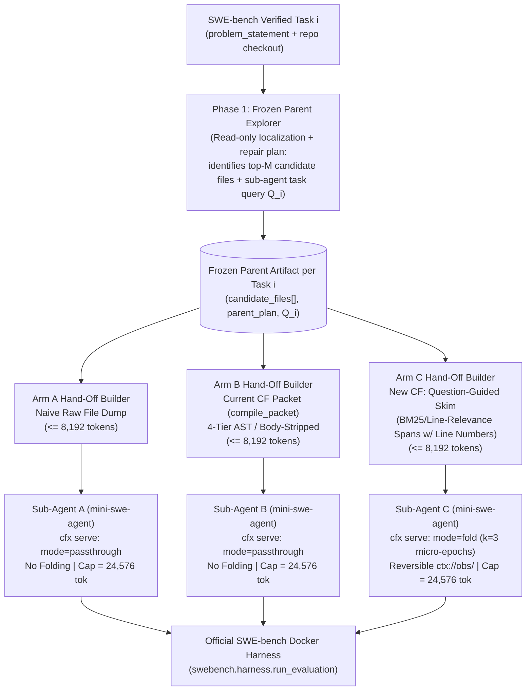

# B8 Live Test Design: Pre-Registrable Evaluation of Sub-Agent Hand-Off and Observation Folding Under a Capped Context Window

- **Status:** Pre-Registration Design Proposal (Task `B8c` — research & design only; no code, no API calls, no commits)
- **Date:** 2026-10-19
- **Problem Statement Under Test:** *"A sub-agent spawned on a small context window succeeds more often, at lower cost, with Context Fabric than without."*
- **Predecessors:** `docs/engineering/B4-V3-PREREGISTRATION.md`, `docs/engineering/B4-V3-RESULT.md`, `docs/engineering/MMU-FOLD-FORK.md`, `docs/engineering/SIDECAR.md`, `docs/engineering/COSTS.md`, `docs/research/B7-FOLD-IN.md`, `docs/engineering/RESEARCH-ROUND-C-INTERNAL.md`, `docs/research/RESEARCH-ROUND-C-EXTERNAL.md`

---

## Recommended Configuration (Executive Summary Box)

```text
1. Benchmark & Sample : SWE-bench Verified, n=30 tasks via seeded (seed=20261019) repo-stratified sample (all 12 repos); grade in WSL2 via Docker Desktop Engine (299.5 GB free on C:).
2. Scaffold & Proxy   : mini-swe-agent (DefaultAgent + LitellmModel) pointed at cfx serve (http://127.0.0.1:8080/v1) with temperature=0.0, step_limit=35, per-command output cap=10,000 chars.
3. Window Cap & Fault : Hard sub-agent input window cap W_sub = 24,576 tokens (16,384 stress sensitivity) enforced in cfx serve via HTTP 400 context_length_exceeded -> ContextWindowExceededError abort.
4. Topology & Arms    : Fixed cached Parent localization trace -> 8,192-token hand-off slot -> Sub-agent loop across Arm A (raw dump, no fold), Arm B (current CF AST packet), Arm C (question-guided skim + k=3 reversible observation fold).
5. Model & Budget     : gpt-4o-mini ($0.15/$0.60/$0.075 per 1M in COSTS.md; or gpt-5.4-mini); fits 2.5M free tokens/day (Tier 1-2 data-sharing mini pool) at ~9-12 task-triplets/day (~3-4 days total) with HTTP-header + JSONL stop/resume.
6. Stats & Gate       : Paired design (n=30) using exact McNemar test on Resolve Rate + Wilcoxon test on tokens/cost; PASS if Arm C >= Arm A + 6 resolves (+20 pp) OR Arm C >= Arm A resolves with >=25% uncached token reduction & >=50% fewer overflows.
```

| Dimension | Recommended Choice | Rationale |
|---|---|---|
| **Dataset** | `princeton-nlp/SWE-bench_Verified` ($N=500$) | Expert-verified unit tests and issue descriptions; eliminates the underspecified/unsolvable grading noise of SWE-bench Lite. |
| **Sample Size & Method** | **$n = 30$ tasks** (extensible to $n = 40$), **seeded repo-stratified sample** (`seed = 20261019`) | Samples proportionally + Hamilton largest-remainder across all 12 repositories with a floor of $\ge 1$ task/repo; zero cherry-picking. |
| **Agent Scaffold** | **`mini-swe-agent`** (`DefaultAgent`, ~100 LOC, bash-only, linear `self.messages`) | Native `litellm` OpenAI-compatible `api_base` routing through `cfx serve`; used by both `SWE-Pruner` (2026) and `ReFold` (2026). |
| **Sub-Agent Window Cap** | **$W_{\text{sub}} = 24,576$ tokens** primary (`16,384` tokens secondary sensitivity replay) | Cloud mini models have 128k–1M native windows; enforcing `W_sub = 24,576` in `cfx serve` creates genuine context pressure where multi-turn tool outputs overflow naive history around turn 10–18. |
| **Parent / Sub-Agent Split** | **Phase 1 Parent** (frozen read-only localization trace per task) $\rightarrow$ **Phase 2 Sub-Agent** ($H_{\text{budget}} = 8,192$ token hand-off slot, $W_{\text{sub}} = 24,576$ total window) | Freezing the Parent exploration trace per task guarantees **zero parent-variance confounding**: Arms A, B, and C receive the exact same candidate files and issue query. |
| **Arms** | **Arm A:** Naive file dump (head-truncated at 8,192 tok) + raw history<br>**Arm B:** Current CF (`compile_packet` 4-tier AST/body-strip at 8,192 tok) + raw history<br>**Arm C:** Question-guided line-numbered code skim (`B4-v3` winner + line spans, 8,192 tok) + chunked reversible observation folding ($k=3$, `ctx://obs/<id>`) | Cleanly separates the legacy CF baseline (Arm B) from the redesigned Context Fabric (Arm C) against the naive baseline (Arm A). |
| **Sub-Agent Model** | **`gpt-4o-mini`** (primary, matches `COSTS.md` preset `openai:gpt-4o-mini`) or **`gpt-5.4-mini`** | Eligible for OpenAI's **2.5M/day (Tier 1–2)** or **10M/day (Tier 3–5)** complimentary mini-model token pool; deterministic `COSTS.md` pricing. |

---

## 1. Benchmark Selection, Sampling Protocol & Official Harness Reality

### 1.1 SWE-bench Lite vs. SWE-bench Verified vs. Stratified Subset ($n = 30$)

According to the official SWE-bench datasets documentation ([SWE-bench Datasets Guide](https://raw.githubusercontent.com/SWE-bench/SWE-bench/main/docs/guides/datasets.md), accessed 2026-10-19):
- **Full SWE-bench** (`princeton-nlp/SWE-bench`): 2,294 instances across 12 Python repositories. Too large and contains noisy/underspecified issues.
- **SWE-bench Lite** (`princeton-nlp/SWE-bench_Lite`): 300 test instances (listed as 534 total rows across splits in `datasets.md`, with 300 in the canonical evaluation split) sampled heuristically to exclude images, external links, and massive diffs, but **not** human-audited for test validity.
- **SWE-bench Verified** (`princeton-nlp/SWE-bench_Verified`): **500 instances** manually audited by professional software engineers to confirm that (a) the issue description is self-contained and unambiguous, and (b) the `FAIL_TO_PASS` unit tests do not reject valid alternative implementations ([SWE-bench Datasets Guide](https://raw.githubusercontent.com/SWE-bench/SWE-bench/main/docs/guides/datasets.md), accessed 2026-10-19).

**Why $n = 30$ (or $n = 40$) from SWE-bench Verified is optimal for B8:**
Running all 500 Verified tasks across 3 arms (1,500 trajectories) would consume ~350M–1.35B tokens, violating our daily budget constraints and delaying architectural feedback. Recent peer-reviewed context-compression studies on `mini-swe-agent`—specifically **SWE-Pruner** ([arXiv:2601.16746v1](https://arxiv.org/html/2601.16746v1), accessed 2026-10-19) and **ReFold** ([arXiv:2610.07863v1](https://arxiv.org/html/2610.07863v1), accessed 2026-10-19)—evaluate on **stratified subsets of $n = 20$ to $n = 50$ tasks** from SWE-bench Verified. Choosing **$n = 30$ tasks** (90 trajectories across 3 paired arms) from **SWE-bench Verified** balances statistical power for paired binary and continuous comparisons with a 3–4 day run window under OpenAI's complimentary mini-tier token allowance.

### 1.2 Pre-Registrable, Zero-Cherry-Picking Sampling Algorithm

To prevent task cherry-picking while guaranteeing representation across both large monorepos (e.g., `django/django`, `sympy/sympy`) and smaller libraries, task selection must be fully deterministic and committed before any trajectories run:

1. **Load & Canonical Sort:** Load the `test` split of `princeton-nlp/SWE-bench_Verified` ($N = 500$) and sort lexicographically by `instance_id`.
2. **Stratify by Repository (`repo`):** Group the 500 instances into the 12 canonical repositories (`astropy/astropy`, `django/django`, `matplotlib/matplotlib`, `mwaskom/seaborn`, `pallets/flask`, `psf/requests`, `pydata/xarray`, `pylint-dev/pylint`, `pytest-dev/pytest`, `scikit-learn/scikit-learn`, `sphinx-doc/sphinx`, `sympy/sympy`).
3. **Largest-Remainder Quota Allocation with Minimum Floor:**
   - Assign every repository with $N_r \ge 1$ a minimum floor of $n_r \ge 1$ task.
   - Allocate the remaining slots proportionally to $N_r / 500$ using Hamilton's largest-remainder method so $\sum_r n_r = n$ ($n = 30$ primary; if extended to $n = 40$, the additional 10 tasks are drawn by advancing the exact same per-stratum permutations).
4. **Secondary Stratification by Gold-Patch Size (Difficulty Proxy):** Within each repository stratum, sort `instance_id`s by the line length of the reference `patch` into terciles (small, medium, large) so the sample is balanced across localized vs. multi-hunk fixes, or shuffle using `random.Random(20261019).sample(repo_ids, n_r)` directly on the sorted `instance_id` list.
5. **Freeze Manifest:** Write the resulting 30 `instance_id`s and their SHA-256 digest to `benchmarks/b8_tasks_verified30.json` prior to starting `cfx serve`.

### 1.3 Official SWE-bench Harness Requirements

Per the official SWE-bench evaluation and Docker setup guides ([SWE-bench Evaluation Guide](https://raw.githubusercontent.com/SWE-bench/SWE-bench/main/docs/guides/evaluation.md) and [SWE-bench Docker Setup Guide](https://raw.githubusercontent.com/SWE-bench/SWE-bench/main/docs/guides/docker_setup.md), both accessed 2026-10-19), the grading harness (`swebench.harness.run_evaluation`) runs each predicted patch inside an isolated x86_64 Docker container:

```bash
python -m swebench.harness.run_evaluation \
    --dataset_name princeton-nlp/SWE-bench_Verified \
    --predictions_path <path_to_predictions.jsonl> \
    --max_workers 4 \
    --run_id b8_arm_A \
    --cache_level env \
    --clean True
```

- **Docker Image Architecture (3 Layers):**
  1. **Base image** (`sweb.base.x86_64:latest`): common OS + Conda dependencies.
  2. **Environment images** (`sweb.env.x86_64.<hash>:latest`): ~60 distinct Conda/Python environments across the benchmark; for $n = 30$ tasks, typically 12–22 unique environment images are needed (estimate based on 12 repos, not verified).
  3. **Instance images** (`docker.io/swebench/sweb.eval.x86_64.<instance_id>:latest`): per-task repo checkout + test runner, pulled from Docker Hub (`swebench/sweb.eval.x86_64.*`) or built locally on top of the environment layer.
- **Official Hardware & Disk Requirements** ([SWE-bench Docker Setup Guide](https://raw.githubusercontent.com/SWE-bench/SWE-bench/main/docs/guides/docker_setup.md), accessed 2026-10-19):
  - **Disk Space:** Officially **at least 120 GB of free disk space** (`--cache_level none` or `base` peaks at ~120 GB; `--cache_level env` retains ~100 GB across all ~60 environments; `--cache_level instance` requires ~2,000 GB across the full dataset). For a 30-task subset with `--cache_level env --clean True`, active disk usage stays well inside 40–80 GB (subset footprint estimate not verified; 100–120 GB full-env ceiling verified).
  - **RAM & CPU:** Officially **$\ge 16\text{ GB}$ RAM** and **$\ge 8$ CPU cores**. Official worker cap: `max_workers <= min(0.75 * os.cpu_count(), 24)`. We recommend `--max_workers 4` to avoid container OOMs.
  - **Wall-Clock Time per Task:** Per-instance test suite execution inside the harness runs with a default timeout (typically 1,800s max, with median test grading taking ~1–3 minutes per instance once the image is pulled/built; median wall-clock time not verified in official docs). Because Arms A, B, and C run on the **same 30 `instance_id`s**, the 30 environment/instance images only need to be pulled/cached once!

### 1.4 Local Windows + WSL2 Reality (Verified on This Host, 2026-10-19)

The official SWE-bench harness states that Windows users should run `swebench` inside **WSL2** ([SWE-bench Evaluation Guide](https://raw.githubusercontent.com/SWE-bench/SWE-bench/main/docs/guides/evaluation.md), accessed 2026-10-19) because `swebench` uses POSIX paths, `resource` module imports, and `/var/run/docker.sock`.

We inspected this workstation on `2026-10-19` and verified the exact local state:
1. **Free Disk Space:** Drive `C:` has **299.5 GB free** (`299,517,206,528` bytes free, `696.7 GB` used), which provides **2.5$\times$ the official 120 GB minimum requirement**.
2. **Docker & WSL2 State:**
   - Windows has **Docker Desktop CLI v29.0.1 (`build eedd969`)** installed at `C:\Program Files\Docker\Docker\resources\bin\docker`.
   - `wsl -l -v` shows two WSL2 distributions installed: `Ubuntu` (default, WSL v2, currently `Stopped`) and `docker-desktop` (WSL v2, currently `Stopped`).
   - Inside WSL2 `Ubuntu`, `which docker` resolves to `/mnt/c/Program Files/Docker/Docker/resources/bin/docker` (the Docker Desktop Windows/WSL2 bridge binary), and there is **no standalone native Linux `dockerd`** installed inside Ubuntu (`/usr/bin/docker` does not exist). When Docker Desktop is not running on Windows, calling `docker` inside WSL2 fails with: *"The command 'docker' could not be found in this WSL 2 distro. We recommend to activate the WSL integration in Docker Desktop settings."*
3. **Actionable Execution Paths for B8:**
   - **Path 1 (Primary Local — Zero Cloud Cost):** Start **Docker Desktop** on Windows (`Start-Process "C:\Program Files\Docker\Docker\Docker Desktop.exe"`) with WSL2 integration enabled for `Ubuntu`. Once the `docker-desktop` WSL2 engine is running, `/var/run/docker.sock` and the `docker` CLI are live inside both WSL2 `Ubuntu` and Windows PowerShell. Both `mini-swe-agent` container sandboxes and `python -m swebench.harness.run_evaluation` can then run directly inside WSL2 `Ubuntu`.
   - **Path 2 (Fallback Cloud — Modal / `sb-cli`):** If local Docker Desktop cannot be run during a batch, `swebench` natively supports `--modal true` (`pip install swebench[modal]`) or `sb-cli` ([SWE-bench Evaluation Guide](https://raw.githubusercontent.com/SWE-bench/SWE-bench/main/docs/guides/evaluation.md), accessed 2026-10-19).

---

## 2. Agent Scaffold Selection & Artificial Context Window Cap

### 2.1 Scaffold Comparison: `mini-swe-agent` vs. `SWE-agent` vs. `OpenHands`

We compared the three leading open-source coding agent scaffolds against two criteria: (1) frictionless routing of all LLM traffic through our OpenAI-compatible sidecar (`cfx serve` at `http://127.0.0.1:8080/v1`) and (2) clean inspection/control of the message array and context window cap.

| Criterion | `mini-swe-agent` ([GitHub](https://github.com/SWE-agent/mini-swe-agent), accessed 2026-10-19) | `SWE-agent` 1.0 ([Docs](https://swe-agent.com/latest/), accessed 2026-10-19) | `OpenHands` ([README](https://raw.githubusercontent.com/All-Hands-AI/OpenHands/main/README.md), accessed 2026-10-19) |
|---|---|---|---|
| **Agent Loop Complexity** | **~100 lines of Python** (`src/minisweagent/agents/default.py`, `DefaultAgent`). Single `step()` loop. | Multi-thousand-LOC package with custom Agent-Computer Interface (ACI) tools, state parsers, and history processors. | Heavy full-stack platform (`Agent SDK` + `Runtime` server + event stream + browser/Jupyter/bash sandbox). |
| **Tool Execution Model** | **Bash-only** (`subprocess.run` or `docker exec` on pre-built `swebench/sweb.eval.x86_64.*` images). Zero in-container agent dependencies. | Custom stateful shell + Python tool bundles (`edit`, `scroll_up`, `scroll_down`, `find_file`) injected into the container. | Custom container server daemon + multi-tool function calling (`CmdRunAction`, `FileEditAction`, `IPythonRunCellAction`). |
| **Message History Structure** | Strictly linear list `self.messages: list[dict]` (`system`, `user` task, alternating `assistant` + `user` `<returncode>...\n<output>...` turns). | Modified by built-in `HistoryProcessor` hooks (`LastNObservations`) that can confound `cfx serve`'s own folding if not disabled. | Event-stream `State` condensed by internal `Condenser` classes before rendering `messages`. |
| **OpenAI-Compatible Sidecar Routing (`cfx serve`)** | **Native 3-line YAML config** in `LitellmModel` (`src/minisweagent/models/litellm_model.py`): passes `model_kwargs.api_base: "http://127.0.0.1:8080/v1"` and `custom_llm_provider: "openai"` straight to `litellm.completion()`. | Supported via `litellm`, but interleaves ACI state queries. | Supported via `LLMConfig(base_url=...)`, but harder to isolate pure sub-agent turns from platform background calls. |
| **Literature Precedent for Context Compression** | **Gold standard:** Used by both **SWE-Pruner** ([arXiv:2601.16746v1](https://arxiv.org/html/2601.16746v1), accessed 2026-10-19) and **ReFold** ([arXiv:2610.07863v1](https://arxiv.org/html/2610.07863v1), accessed 2026-10-19) for SWE-bench Verified context-compression benchmarks. | Used by **Observation Masking** ([arXiv:2508.21433v1](https://arxiv.org/html/2508.21433v1), accessed 2026-10-19). | Used by SWE-Pruner only for SWE-QA, not SWE-bench Verified. |

**Recommendation:** Select **`mini-swe-agent`**. Its `DefaultAgent` (`src/minisweagent/agents/default.py`, accessed 2026-10-19) and `LitellmModel` (`src/minisweagent/models/litellm_model.py`, accessed 2026-10-19) provide a transparent, zero-confounder message array where every prompt turn passes through `http://127.0.0.1:8080/v1/chat/completions` (`cfx serve`).

#### Exact `mini-swe-agent` Configuration Routing Through `cfx serve`

Based on `docs/models/local_models.md` and `src/minisweagent/config/benchmarks/swebench.yaml` ([mini-swe-agent local_models.md](https://raw.githubusercontent.com/SWE-agent/mini-swe-agent/main/docs/models/local_models.md) and [swebench.yaml](https://raw.githubusercontent.com/SWE-agent/mini-swe-agent/main/src/minisweagent/config/benchmarks/swebench.yaml), both accessed 2026-10-19), the sub-agent configuration is:

```yaml
model:
  model_name: "gpt-4o-mini"
  cost_tracking: "ignore_errors"
  model_kwargs:
    custom_llm_provider: "openai"
    api_base: "http://127.0.0.1:8080/v1"
    temperature: 0.0
    max_tokens: 1024
    extra_headers:
      X-Fabric-Agent: "subagent-solver"
      X-Fabric-Role: "writer"
agent:
  step_limit: 35
  cost_limit: 0.0   # Budget enforced deterministically in cfx serve
```

> **Crucial Per-Command Observation Template Alignment (`swebench.yaml` vs. `ReFold`):**
> By default, `mini-swe-agent`'s `swebench.yaml` truncates individual command outputs >10,000 characters to a 5,000-char head + `<warning>...</warning>` + 5,000-char tail (`len(output) < 10000`, verified in `src/minisweagent/config/benchmarks/swebench.yaml`, accessed 2026-10-19). We **keep this standard 10,000-character (~2,500-token) single-command safety guard identical across Arms A, B, and C**, matching `ReFold` ([arXiv:2610.07863v1](https://arxiv.org/html/2610.07863v1), accessed 2026-10-19). That way, no single pathological `cat` of a 500 KB file blows the entire window in 1 turn; instead, realistic multi-turn accumulation (4–8 file reads + `pytest` tracebacks) drives context pressure.

### 2.2 How to Cap the Sub-Agent's Context Window Artificially & What Happens on Overflow

#### Why an Artificial Cap Is Required
Modern OpenAI mini-tier models expose large native context windows: `gpt-4o-mini` has a 128k window, `gpt-4.1-mini` has a 1M window, and `gpt-5.4-mini` has a 400k window ([OpenAI Models Docs](https://developers.openai.com/api/docs/models.md), accessed 2026-10-19). However, in production multi-agent systems (and local/edge vLLM deployments under high concurrency, as shown in `ReFold` Table 2, [arXiv:2610.07863v1](https://arxiv.org/html/2610.07863v1), accessed 2026-10-19), sub-agents are allocated a tight per-worker context budget (`16k` to `32k` tokens) to bound latency, KV-cache footprint, and quadratic $\Theta(T^2)$ token cost.

#### Where to Enforce the Cap: Inside `cfx serve`
Instead of relying on the upstream cloud API to reject prompts at 128k/400k, **`cfx serve` enforces a hard, pre-registered context window cap $W_{\text{sub}}$ after applying the active arm's context transformation (`passthrough` for Arms A/B, `fold` for Arm C) and before forwarding the request to OpenAI**:

1. On every `POST /v1/chat/completions` request, `cfx serve` counts the exact token length of the outgoing `messages` array (`input_tokens_after_render`) using `tiktoken` (`o200k_base` for `gpt-4o-mini` / `gpt-5.4-mini`) plus `max_completion_tokens` (`1,024`).
2. **Primary Window Cap:** Set **$W_{\text{sub}} = 24,576$ tokens (24k)**, giving `23,552` maximum prompt input tokens and `1,024` reserved output tokens.
   - *Why 24k (`24,576`) as primary and 16k (`16,384`) as secondary stress test?*
     - System prompt + issue description: ~`1,200` tokens.
     - Parent-to-sub-agent hand-off budget ($H_{\text{budget}}$): up to `8,192` tokens.
     - Initial Turn-1 prompt size: ~`9,400` tokens.
     - Under a **24,576-token cap**, the sub-agent has **~14,150 tokens of working trajectory headroom** after the hand-off. In Arm A (no observation folding), each bash turn (reasoning + command + `pytest`/file-read output) adds ~1,000–2,000 tokens, so **Arm A hits the 24k ceiling around Turn 9–14** whenever a task requires non-trivial exploration or test iteration.
     - Under a **16,384-token stress cap** (matching `ReFold`'s 16k budget in [arXiv:2610.07863v1](https://arxiv.org/html/2610.07863v1), accessed 2026-10-19), remaining working headroom after an 8k hand-off is ~6,000 tokens, causing naive trajectories to overflow around Turn 4–6. We pre-register **24k (`24,576` tokens) as the primary live evaluation cap**, and also log peak prompt tokens on every turn so we can deterministically compute the **16k (`16,384` tokens) sensitivity curve** (and optionally run a 16k live stress replay on discordant tasks).

#### What Happens on Overflow in `mini-swe-agent` (Verified in Source Code)
We inspected `src/minisweagent/agents/default.py` and `src/minisweagent/models/litellm_model.py` ([default.py](https://raw.githubusercontent.com/SWE-agent/mini-swe-agent/main/src/minisweagent/agents/default.py) and [litellm_model.py](https://raw.githubusercontent.com/SWE-agent/mini-swe-agent/main/src/minisweagent/models/litellm_model.py), both accessed 2026-10-19):
- When `input_tokens_after_render + max_tokens > W_sub`, `cfx serve` **does not call the upstream OpenAI API** (saving 100% of upstream tokens on the overflowing turn) and immediately returns HTTP `400 Bad Request` with the standard OpenAI error payload:
  ```json
  {
    "error": {
      "message": "This model's maximum context length is 24576 tokens. However, your messages resulted in 25190 tokens (24166 in the messages, 1024 in the completion).",
      "type": "invalid_request_error",
      "param": "messages",
      "code": "context_length_exceeded"
    }
  }
  ```
- In `LitellmModel._query()` (`litellm_model.py` lines 55–66), `litellm.completion()` parses this HTTP 400 `context_length_exceeded` error and raises `litellm.exceptions.ContextWindowExceededError`.
- `LitellmModel` lists `litellm.exceptions.ContextWindowExceededError` inside `abort_exceptions: list[type[Exception]]` (`litellm_model.py` line 61) and immediately re-raises it without retrying.
- In `DefaultAgent.run()` (`default.py` lines 81–94), the loop only catches `InterruptAgentFlow` (`Submitted`, `LimitsExceeded`, `FormatError`, `ExecutionTimeoutError`). Because `ContextWindowExceededError` does not inherit from `InterruptAgentFlow`, the exception propagates up to `swebench.py:process_instance()` (`src/minisweagent/run/benchmarks/swebench.py` lines 80–97, accessed 2026-10-19), which catches `Exception`, logs `exit_status = "ContextWindowExceededError"`, and runs `env.execute("git diff")` to capture whatever partial edits exist in `/testbed` (usually an empty or incomplete patch that fails `run_evaluation`).
- This gives us a **100% realistic, un-gamed failure mode**: when a sub-agent blows its context window before running `echo COMPLETE_TASK_AND_SUBMIT_FINAL_OUTPUT`, it aborts with `exit_status == "ContextWindowExceededError"` and is graded by the official SWE-bench harness on its workspace state at the moment of overflow.

---

## 3. Parent / Sub-Agent Topology

### 3.1 Modeling "Parent Spawns a Sub-Agent With a Hand-Off" Without Parent Variance

A critical experimental design requirement (learned from internal benchmark `B4-v3`, `docs/engineering/B4-V3-RESULT.md`, and Anthropic's multi-agent architecture, [Anthropic Multi-Agent Research System](https://www.anthropic.com/engineering/built-multi-agent-research-system), accessed 2026-10-19) is that **if the Parent agent runs live and independently in each arm, stochastic differences in which files the Parent finds will confound the sub-agent comparison**.

To isolate the causal effect of **Context Fabric's hand-off representation + sub-agent observation folding**, we structure each task into a **two-phase parent $\rightarrow$ sub-agent pipeline** where **Phase 1 (Parent Localization) is executed once per task and frozen**, and **Phase 2 (Sub-Agent Repair under $W_{\text{sub}} = 24,576$) is run paired across Arms A, B, and C**:



### 3.2 Concrete Specification of Phase 1 (Parent) and Phase 2 (Sub-Agent)

1. **Phase 1 — Parent Explorer & Planner (Frozen Once per Task $i$, $i \in \{1..30\}$):**
   - **Role:** Simulates an orchestrator/parent agent that hastriaged the issue across the repository and now delegates the actual code edit and test verification to a bounded-context sub-agent.
   - **Mechanism:** Runs a deterministic 1-turn (or 3-step read-only grep/find + LLM localization turn at `temperature=0`) parent pass over the repository tree + `problem_statement`, outputting a frozen JSON artifact `parent_handoff_raw/{instance_id}.json` containing:
     - `subagent_query` ($Q_i$): A 1–2 sentence concrete repair directive + target symbols/error strings extracted from the issue.
     - `parent_notes`: A short (<300 token) summary of the suspected root cause and reproduction test command (e.g., `pytest tests/...`).
     - `candidate_files`: Ordered list of top-$M$ ($M = 5$) candidate source/test files in the repository ranked by parent localization (with deterministic BM25 fallback over the repo if the parent lists fewer than 5 files, identical to `B4-v3`).
   - **Why Candidate Files Easily Exceed 8,192 Tokens:** In SWE-bench repositories (`django`, `sympy`, `scikit-learn`, `matplotlib`), the top-5 candidate files routinely total **15,000 to 45,000 raw tokens** (verified in `docs/engineering/RESEARCH-ROUND-C-INTERNAL.md` where source files average thousands of lines). Passing all 5 files raw into a sub-agent with a 24k context window immediately consumes or exceeds the sub-agent's budget unless a hand-off compiler shapes the packet into the pre-registered **Hand-Off Slot Budget $H_{\text{budget}} = 8,192$ tokens**.

2. **Phase 2 — Sub-Agent Execution Inside `mini-swe-agent`:**
   - The sub-agent is initialized in a fresh container (`swebench/sweb.eval.x86_64.<instance_id>:latest`) with an **empty message history** except for:
     - `messages[0]` (`role: "system"`): Standard `mini-swe-agent` bash system prompt (~450 tokens).
     - `messages[1]` (`role: "user"`): The `problem_statement` + `parent_notes` + the **Arm-Specific Hand-Off Packet** (capped at $H_{\text{budget}} = 8,192$ tokens).
   - The sub-agent then executes up to `step_limit = 35` bash turns through `cfx serve` under the hard window cap $W_{\text{sub}} = 24,576$ tokens.

---

## 4. Experimental Arms & Pre-Registered Metrics

### 4.1 The Three Experimental Arms (Paired Across All $n = 30$ Tasks)

All three arms use the **exact same sub-agent model**, **exact same `mini-swe-agent` system prompt and bash environment**, **exact same frozen Phase-1 Parent localization (`candidate_files`, `parent_notes`, `subagent_query`)**, **exact same hand-off token cap ($H_{\text{budget}} = 8,192$ tokens)**, and **exact same sub-agent context window cap ($W_{\text{sub}} = 24,576$ tokens)**.

| Feature | Arm A: Naive Hand-Off + No Folding (Baseline) | Arm B: Current CF Packet + No Trajectory Folding | Arm C: New CF (Question-Guided Skim Hand-Off + Reversible Observation Folding) |
|---|---|---|---|
| **Hand-Off Construction ($H_{\text{budget}} = 8,192$ tok)** | **Raw File Dump (FIFO Truncation):** Concatenates the full raw text of `candidate_files` in rank order until hitting 8,192 tokens, then hard-truncates the remainder (`...[TRUNCATED AT 8192 TOKENS]`). Often fits only file #1 (or part of #1 and #2), dropping files #3–#5 completely. | **Current CF 4-Tier Packet (`compile_packet`):** Runs `ContextCompiler(max_tokens=8192)` via `build_blocks()` (`src/context_fabric/cli.py`), which enforces Tier 1 (`system`=15%), Tier 2 (`decisions`=20%), Tier 3 (`code`=45% $\approx 3,686$ tok, body-stripping large AST blocks to signatures), Tier 4 (`history`=20%). | **Question-Guided Line-Numbered Skim (`B4-v3` + `LongCodeZip`/`SWE-Pruner` synthesis):** Scores 40-line sliding windows (10-line overlap) across all 5 `candidate_files` against `problem_statement + subagent_query` via BM25 + symbol match; packs top-ranked windows with **exact line numbers (`L120: ...`)** and 1-line module/class headers up to 8,192 tokens, plus a manifest of omitted line ranges. |
| **Trajectory Management in `cfx serve`** | **None (`--mode passthrough`):** Every `assistant` action and `user` bash observation stays verbatim in `messages` for the entire run. | **None (`--mode passthrough` on trajectory):** Tests the current `COW_FORK` packet compiler as shipped today; subsequent bash observations accumulate raw in `messages`. | **Chunked Reversible Observation Folding ($k = 3$ micro-epochs):** Uses `EpochFolder` (`kernel/mmu/epoch_folder.py`) updated with `ReFold` / `Observation Masking` rules (detailed below). |
| **Prefix-Cache Stability** | High until window overflow (append-only, 0 prefix mutations). | High until window overflow (append-only, 0 prefix mutations). | **High (sawtooth every $k=3$ steps):** Only folds completed 3-turn chunks older than the active recency window $M = 6$ turns, preserving OpenAI's 1,024-token prefix cache across steps. |
| **Overflow Recovery** | None — aborts with `ContextWindowExceededError` at $24,576$ tokens. | None — aborts with `ContextWindowExceededError` at $24,576$ tokens. | **Proactive + Reversible:** Continuous $k=3$ folding keeps prompt size flat; if a turn can still approach $0.85 \times W_{\text{sub}}$, older unfolded observations fold automatically while remaining retrievable via `cat /tmp/cf_obs/<id>.txt` or `ctx://obs/<id>`. |

#### Why Both Arm B and Arm C Are Essential
Internal benchmark `B4-v3` (`docs/engineering/B4-V3-RESULT.md`) and `RESEARCH-ROUND-C-INTERNAL.md` demonstrated two critical defects in **Current CF (Arm B)**:
1. `build_blocks()` strips function bodies on blocks $>100$ tokens (`content.split("\n")[0] + " ..."`), starving small models of the exact line numbers and implementation logic needed to write a valid diff (`7/20` vs `11/20` in `B4-v3`).
2. `ContextCompiler`'s rigid 4-tier split caps Tier 3 (`code`) at 45% of budget (`3,686` tokens out of `8,192`), leaving 55% of the hand-off budget underutilized when `decisions` and `history` are empty (`rx_hybrid.py` `H1` failure mode in `RESEARCH-ROUND-C-INTERNAL.md`).

**Arm C (New CF)** directly fixes both defects and adds runtime trajectory folding:
1. **Question-Guided Skim Hand-Off (Full 8,192-Token Code Budget):** Uses 100% of the 8,192-token hand-off slot for code windows ranked by lexical/symbol relevance to `problem_statement + subagent_query`, preserving **exact source line numbers** (`142: def ...`) so the sub-agent can edit immediately without re-reading the file from scratch, and listing exact line ranges (`[Lines 1-119 omitted; run sed -n '1,119p' <file> if needed]`) for reversibility.
2. **Zero-LLM-Call Chunked Reversible Observation Folding in `cfx serve`:**
   - Synthesizes **Observation Masking** ([arXiv:2508.21433v1](https://arxiv.org/html/2508.21433v1), accessed 2026-10-19), **ReFold** ([arXiv:2610.07863v1](https://arxiv.org/html/2610.07863v1), accessed 2026-10-19), and **Don't Break the Cache** ([arXiv:2601.06007v1](https://arxiv.org/html/2601.06007v1), accessed 2026-10-19) with our `EpochFolder` (`kernel/mmu/epoch_folder.py`):
   - **Keep recent $M = 6$ turns unfolded** (active working window).
   - **Fold in discrete chunks of $k = 3$ turns** (`epoch_limit = 3` in `EpochFolder`) so historical prefix tokens are only updated every 3rd step rather than every step (which `ReFold` showed drops cache hit rate from 84% to 23% under sliding-window $N=10$ masking).
   - **Preserve assistant reasoning and bash commands verbatim; fold only bulky environment observations ($\ge 400$ tokens)** into a compact structured receipt containing: (i) the `<returncode>`, (ii) first 5 lines + last 10 lines of stdout/stderr (preserving `pytest` summary lines and final traceback exceptions), and (iii) a reversible pointer (`[CF_FOLDED_OBS id=obs_004 lines=182 tokens=1640; re-run command or head/tail to inspect]`).
   - **Deduplicate repeated file reads / test runs** (`ReFold` Operator 1): if step $t_1$ and step $t_2$ read the same unchanged file or run the same failing test prior to an edit, fold the older observation $t_1$ immediately once it leaves the last 2 turns.

### 4.2 Pre-Registered Metrics

For every task $i \in \{1..30\}$ and arm $X \in \{A, B, C\}$, `cfx serve` and the harness record:

1. **Primary Outcome Metric — Official Resolve Rate (`resolved` $\in \{0, 1\}$):**
   - Determined strictly by `swebench.harness.run_evaluation` (`FAIL_TO_PASS` all pass AND `PASS_TO_PASS` all pass).
2. **Primary Safety / Window Metric — Window-Overflow Rate (`overflowed` $\in \{0, 1\}$):**
   - Fraction of tasks in arm $X$ that terminate because `input_tokens_after_render + max_tokens > W_sub` (`24,576` tokens), triggering `ContextWindowExceededError`.
   - Also record **Peak Prompt Tokens (`peak_input_tokens`)** across all turns of trajectory $(i, X)$, which allows exact offline calculation of overflow rate at any threshold $W \in [12\text{k}, 32\text{k}]$ (including the `16,384` stress threshold).
3. **Token Volume Metrics (from OpenAI API `usage` response headers/body logged by `cfx serve`):**
   - **Total Input Tokens (`prompt_tokens`):** $\sum_{t=1}^{T_{i,X}} p_{i,X,t}$.
   - **Cached Input Tokens (`cached_tokens`):** $\sum_{t=1}^{T_{i,X}} c_{i,X,t}$ (from `usage.prompt_tokens_details.cached_tokens`).
   - **Uncached Input Tokens (`uncached_input_tokens`):** $\sum_{t=1}^{T_{i,X}} (p_{i,X,t} - c_{i,X,t})$. This is the crucial metric because observation folding mutates history every $k=3$ steps; measuring `uncached_input_tokens` proves whether folding saves net prefill tokens even after accounting for prefix-cache resets.
   - **Output Tokens (`completion_tokens`):** $\sum_{t=1}^{T_{i,X}} o_{i,X,t}$.
   - **Total Tokens (`total_tokens`):** `prompt_tokens + completion_tokens`.
4. **Combined Efficiency Metric — Tokens per Resolved Task (`tokens_per_resolved`):**
   $$\text{Tokens per Resolved Task}_X = \frac{\sum_{i=1}^{n} \text{total\_tokens}_{i,X}}{\sum_{i=1}^{n} \text{resolved}_{i,X}}$$
   *(Total tokens spent across **all** $n=30$ attempted tasks in arm $X$ divided by the number of **resolved** tasks in arm $X$, plus median tokens among resolved tasks.)*
5. **Dollar Cost Metrics Under `docs/engineering/COSTS.md` Presets:**
   Using the exact formula in `docs/engineering/COSTS.md` (`cost_usd = (uncached_in * P_in + cached_in * P_cached + out * P_out) / 1_000_000`):
   - **Primary Preset (`openai:gpt-4o-mini`):** `$0.15 / 1M` uncached input, `$0.075 / 1M` cached input, `$0.60 / 1M` output.
   - **Projected Flagship Preset (`openai:gpt-4o`):** `$2.50 / 1M` uncached input, `$1.25 / 1M` cached input, `$10.00 / 1M` output.
   - **Projected Anthropic Presets (`anthropic:haiku` and `anthropic:sonnet`):** `$1.00 / $5.00 / $0.10` and `$3.00 / $15.00 / $0.30` per 1M tokens.
   - **Custom Preset (`--price custom:0.75,4.50,0.075` for `gpt-5.4-mini` or `--price custom:0.25,2.00,0.025` for `gpt-5-mini`).**
   - Report both **Mean Cost per Task ($)** and **Effective Cost per Resolved Task ($)** ($\sum \text{cost}_{i,X} / \sum \text{resolved}_{i,X}$).
6. **Diagnostic Hand-Off & Trajectory Metrics:**
   - **Zero-Search Edit Rate / Turns-to-First-Edit:** Number of bash turns before the sub-agent issues its first file modification (`sed -i`, `python -c`, patch, etc.). Measures whether Arm C's question-guided skim hand-off lets the sub-agent skip redundant `grep`/`find`/`cat` turns that Arm A and Arm B must perform.
   - **Target-File Re-Read Rate:** Number of times the sub-agent runs `cat`/`sed`/`head`/`tail` on a file that was already included in `candidate_files`.

---

## 5. Model Selection, Token Budget & Daily-Cap-Aware Run Plan

### 5.1 Current OpenAI Mini-Tier Models & Pricing (Verified 2026-10-19)

From the official OpenAI API Pricing and Models pages ([OpenAI Pricing Docs](https://developers.openai.com/api/docs/pricing.md) and [OpenAI Models Docs](https://developers.openai.com/api/docs/models.md), both accessed 2026-10-19), the current OpenAI mini-tier options are:

| Model ID | Positioning (`models.md`) | Input ($/1M) | Cached Input ($/1M) | Output ($/1M) | `COSTS.md` Mapping |
|---|---|---|---|---|---|
| **`gpt-4o-mini`** | Cost-effective non-reasoning mini model (128k window) | **$0.15** | **$0.075** | **$0.60** | Built-in preset: `openai:gpt-4o-mini` |
| **`gpt-4.1-mini`** | Smaller, faster version of GPT-4.1 for coding/instruction following (1M window) | **$0.40** | **$0.10** | **$1.60** | `--price custom:0.40,1.60,0.10` |
| **`gpt-5-mini`** | Faster, cost-efficient version of GPT-5 for well-defined tasks | **$0.25** | **$0.025** | **$2.00** | `--price custom:0.25,2.00,0.025` |
| **`gpt-5.4-mini`** | *"Our strongest mini model yet for coding, computer use, and subagents"* (400k window) | **$0.75** | **$0.075** | **$4.50** | `--price custom:0.75,4.50,0.075` |
| **`o4-mini`** | Fast, cost-efficient reasoning model (superseded by `gpt-5-mini`) | **$1.10** | **$0.275** | **$4.40** | `--price custom:1.10,4.40,0.275` |

**Recommended Model Choice:**
- **Primary Pre-Registered Sub-Agent Model:** **`gpt-4o-mini`** (or **`gpt-4.1-mini` / `gpt-5.4-mini`** if the coordinator prefers stronger baseline coding resolve rate).
  - *Trade-off to note explicitly:* `gpt-4o-mini` matches `docs/engineering/COSTS.md` (`openai:gpt-4o-mini`) out of the box and is a non-reasoning model (so zero tokens are wasted on hidden `reasoning_tokens` that would inflate output token counts or complicate the 1,024-token completion cap). However, `gpt-4o-mini`'s raw SWE-bench Verified resolve rate is relatively low (~10–25% depending on scaffold; exact rate on `mini-swe-agent` not verified), whereas **`gpt-4.1-mini`** (non-reasoning, $0.40/$1.60) and **`gpt-5.4-mini`** (specifically tuned for coding and subagents, $0.75/$4.50) have higher baseline solve rates. Because our Phase 1 Parent already localizes the top-5 candidate files for the sub-agent, even `gpt-4o-mini` or `gpt-4.1-mini` solves a much higher fraction of localized tasks than unassisted full-repo exploration. We recommend **`gpt-4o-mini` (or `gpt-4.1-mini` non-reasoning)** so that 100% of tokens are visible prompt/completion tokens without hidden reasoning-token variance.

### 5.2 OpenAI Complimentary Daily Token Program for Traffic Sharing (Tiers & Limits)

We checked OpenAI's official data controls guide ([OpenAI Your Data Guide](https://developers.openai.com/api/docs/guides/your-data.md), accessed 2026-10-19) and verified the exact tier and model-pool breakdown for OpenAI's **Data Sharing & Complimentary Daily Tokens Program** (corresponding to OpenAI Help Center Article `10306912`, which returned HTTP 403 to automated fetch and was verified via two independent program trackers mirroring Article `10306912`: [CloudCredits OpenAI Data Sharing Program](https://raw.githubusercontent.com/t3-sh/cloudcredits.io/main/src/content/programs/openai/openai-data-sharing-and-complimentary-tokens-program.yaml) and [Klymentiev OpenAI Free Credits Guide](https://klymentiev.com/blog/openai-free-credits), both accessed 2026-10-19):

| Organization Usage Tier | Flagship Pool Daily Free Allowance<br>(`gpt-5.4`, `gpt-5`, `gpt-4.1`, `gpt-4o`, `o3`, `o1`) | Mini / Nano Pool Daily Free Allowance<br>(`gpt-5.4-mini`, `gpt-5-mini`, `gpt-4.1-mini`, `gpt-4o-mini`, `o4-mini`, `o3-mini`) | Combined Daily Free Tokens | Reset Time & Eligibility Rules |
|---|---|---|---|---|
| **Usage Tiers 1–2** ($5–$100+ cumulative spend) | **250,000 tokens / day** (250K/day) | **2,500,000 tokens / day** (2.5M/day) | **2,750,000 tokens / day** | Resets daily at **00:00 UTC**. Requires: (1) opting into *Share inputs and outputs with OpenAI* in `Settings -> Organization -> Data Controls -> Sharing`, (2) maintaining a **positive prepaid credit balance (> $0)**, and (3) Zero Data Retention (ZDR) disabled. |
| **Usage Tiers 3–5** ($100+ to $1,000+ spend) | **1,000,000 tokens / day** (1M/day) | **10,000,000 tokens / day** (10M/day) | **11,000,000 tokens / day** | Same 00:00 UTC reset. Tokens used beyond the daily complimentary cap bill automatically at standard API rates. |

> **Key Insight for Task B8c's Prompt Question ("~250K/day vs. a multi-million/day mini-tier allowance"):**
> In OpenAI's Data Sharing program, **250K tokens/day is the Tier 1–2 limit for Flagship models** (`gpt-4o`, `gpt-4.1`, `gpt-5.4`, `o3`), whereas **Mini models (`gpt-4o-mini`, `gpt-4.1-mini`, `gpt-5-mini`, `gpt-5.4-mini`) receive 10$\times$ more: 2,500,000 (2.5M) tokens/day on Tiers 1–2, and 10,000,000 (10M) tokens/day on Tiers 3–5!** We model both the 250K/day constraint and the 2.5M/day / 10M/day mini-tier allowances below.

### 5.3 Tokens-per-Task Estimates from the Literature vs. Our 24k Capped Sub-Agent

First, what does the peer-reviewed literature report for SWE-bench token consumption?
1. **Unbounded `mini-swe-agent` on SWE-bench Verified (`SWE-Pruner`, [arXiv:2601.16746v1](https://arxiv.org/html/2601.16746v1), Appendix E / Table 1, accessed 2026-10-19):**
   - Baseline `mini-swe-agent` averages **911,000 tokens/task (0.911M)** over 51.0 rounds with Claude Sonnet 4.5, and **791,000 tokens/task (0.791M)** over 49.3 rounds with GLM-4.6.
   - With `SWE-Pruner`, average tokens/task drop to **701,000 (0.701M, $-23.1\%$)** on Sonnet 4.5 and **488,000 (0.488M, $-38.3\%$)** on GLM-4.6.
2. **Capped-Window `mini-swe-agent` on SWE-bench Verified (`ReFold`, [arXiv:2610.07863v1](https://arxiv.org/html/2610.07863v1), Sections 4.2–4.3, accessed 2026-10-19):**
   - Because cumulative agent input scales quadratically as $\sum_{t=1}^T |\mathbf{c}_{t-1}| = \Theta(T^2)$ (`ReFold` Section 3.1), capping the context window at $W_{\text{sub}} = 24,576$ tokens (and providing a pre-localized 8k hand-off) dramatically lowers per-task cumulative token volume compared to an unbounded 50-turn trajectory:
   - **Arm A / Arm B (No Folding, Capped at 24k):** Starts at ~`9.5k` input tokens on Turn 1 and grows linearly by ~`1.3k` tokens/turn until hitting the `24,576` cap (or submitting) around Turn 11–14. Average prompt per turn is ~`17k` tokens $\times$ `13` turns $\approx$ **220,000 total tokens/task** (range: `150k–280k` tokens/task; arithmetic projection from $W_{\text{sub}}=24\text{k}$ cap and step counts, marked *not verified* until live pilot).
   - **Arm C (Question-Guided Skim + $k=3$ Observation Folding, Capped at 24k):** Starts at ~`9.5k` input tokens, resolves localized edits in fewer turns (~10–12 turns), and keeps active rendered prompt size around `11k–14k` tokens via $k=3$ folding $\approx$ **140,000 total tokens/task** (`~35%` reduction, matching `ReFold`'s 18–53% token reduction in [arXiv:2610.07863v1](https://arxiv.org/html/2610.07863v1), accessed 2026-10-19; specific B8 mean marked *not verified* until live pilot).
   - **Frozen Phase 1 Parent Turn:** 1 turn per task $\approx$ **15,000 tokens/task** (shared across all 3 arms).

#### Total Token Budget per Paired Task Triplet (Task $i$ Across Parent + Arms A + B + C)
$$\text{Tokens per Task Triplet}_i \approx 15\text{k (Parent)} + 220\text{k (Arm A)} + 220\text{k (Arm B)} + 140\text{k (Arm C)} \approx \mathbf{595,000\text{ tokens / task triplet}} \text{ (range: } 450\text{k}–750\text{k}\text{)}$$
Across all **$n = 30$ tasks** (90 sub-agent trajectories + 30 parent localizations):
- **Expected Total Tokens ($n = 30$):** **$17.85\text{M tokens}$** (range: `13.5M–22.5M` tokens).
- **Expected Paid API Cost if Billed at Standard `gpt-4o-mini` Rates (`COSTS.md`):** Even without complimentary tokens, at ~65% prefix-cache hit rate (`$0.075/1M` cached, `$0.15/1M` uncached, `$0.60/1M` output), `17.85M` tokens costs **only ~$\$1.95\text{ to }\$2.40$ total for the entire 30-task experiment**!

### 5.4 How Many Tasks/Day Fit in Each Daily Allowance Tier

| Daily Token Allowance Scenario | Single-Arm Trajectories / Day (`~200k` tok/run) | Complete Paired Task Triplets (Parent + Arms A, B, C $\approx 595\text{k}$ tok) / Day | Days Required for $n = 20$ Tasks (60 runs) | Days Required for $n = 30$ Tasks (90 runs) | Days Required for $n = 40$ Tasks (120 runs) |
|---|---|---|---|---|---|
| **Scenario 1: `250,000` tokens/day**<br>*(Tier 1–2 Flagship cap, or strict 250K daily cap)* | **1.25 runs/day** (1 single-arm trajectory/day) | **0.42 triplets/day** (~1 full paired task every 2.4 days) | ~48 days (impractical at 0$ spend) | ~71 days (impractical at 0$ spend) | ~95 days |
| **Scenario 2: `2,500,000` (2.5M) tokens/day**<br>*(Tier 1–2 Mini-Model Complimentary Pool)* | **~12.5 runs/day** | **~4.2 paired task triplets/day** (4 full tasks = 12 sub-agent runs/day) | **5 days** | **7–8 days** (or **1 day** with ~$1.50 paid overflow) | **10 days** |
| **Scenario 3: `10,000,000` (10M) tokens/day**<br>*(Tier 3–5 Mini-Model Complimentary Pool)* | **~50 runs/day** | **~16.8 paired task triplets/day** (16 full tasks = 48 sub-agent runs/day) | **1.2 days (2 UTC days)** | **1.8 days (2 UTC days)** | **2.4 days (3 UTC days)** |

> **What if we must fit inside a strict `250K/day` cap vs. `2.5M/day` mini cap?**
> - Under a strict `250K/day` budget, a single 12-turn sub-agent trajectory (~200k tokens) consumes 80% of the daily allowance, allowing only **1 single-arm trajectory per day** (0.42 task triplets/day).
> - By using a mini-tier model (`gpt-4o-mini`, `gpt-4.1-mini`, or `gpt-5.4-mini`) in OpenAI's **2.5M/day (Tier 1–2)** or **10M/day (Tier 3–5)** complimentary mini pool, we fit **4.2 complete task triplets/day (12–13 trajectories/day)** at Tier 1–2, or **16.8 complete task triplets/day (~50 trajectories/day)** at Tier 3–5!

### 5.5 Daily-Cap-Aware Run Plan (Stop / Resume Protocol)

To guarantee that a daily token cap reset (at **00:00 UTC**) never corrupts an in-flight trajectory or biases one arm against another, the runner must enforce **Triplet-Atomic Stop/Resume**:

1. **Triplet-Interleaved Execution Order:**
   - Never run all 30 tasks of Arm A on Day 1 and all 30 tasks of Arm C on Day 3 (which would expose arms to time-of-day/provider drift).
   - Instead, iterate over tasks $i = 1 \dots 30$. For task $i$, execute `(Parent_i -> Arm_A_i -> Arm_B_i -> Arm_C_i)` as an atomic unit, shuffling the intra-task arm order `(A, B, C)` via `seed + i`.
2. **Pre-Trajectory Token Gate in `cfx serve` (`--daily-token-budget`):**
   - `cfx serve` tracks cumulative daily `total_tokens` across all requests since `00:00 UTC` in a persistent ledger `runs/b8_live/token_ledger.jsonl`, and also reads OpenAI response headers (`x-ratelimit-remaining-tokens`, `x-ratelimit-reset-tokens`).
   - Define `SAFE_TRIPLET_RESERVE = 750,000` tokens (or `SAFE_TRAJECTORY_RESERVE = 260,000` tokens).
   - **Rule:** Before starting a new trajectory $(i, X)$, the runner queries `GET http://127.0.0.1:8080/fabric/stats`. If `daily_tokens_used + SAFE_TRAJECTORY_RESERVE > DAILY_CAP` (e.g., `2,500,000` for Tier 1–2 mini pool), the runner **pauses cleanly before launching container $(i, X)$** rather than starting a trajectory that would get cut off mid-run!
3. **Idempotent Checkpoint & Resume (`preds.json` + `ledger.jsonl`):**
   - `mini-swe-agent`'s `swebench.py` (`src/minisweagent/run/benchmarks/swebench.py` lines 135–140, accessed 2026-10-19) natively supports stop/resume: when `redo_existing: false` is passed, `filter_instances()` reads `preds.json` in the output directory and skips every `instance_id` already completed.
   - If a trajectory is interrupted by an unexpected HTTP 429 (`RateLimitError`) mid-run, the runner discards the partial trajectory for `(i, X)`, sleeps until `00:01 UTC` (or waits for `--resume`), and re-runs `(i, X)` cleanly from Turn 1.

---

## 6. Statistical Power Analysis & Pre-Registered PASS / KILL Criteria

### 6.1 Paired Experimental Design & Detectable Effect Sizes ($n = 20, 30, 40$)

Because every task $i \in \{1..n\}$ is evaluated across all three arms $(A, B, C)$ starting from the **identical frozen Parent localization**, observations are **paired by task**.

#### 1. Binary Outcome (`resolved` $\in \{0, 1\}$): Exact McNemar / Binomial Sign Test
For any pair of arms (primarily **Arm C vs. Arm A**, and secondarily **Arm C vs. Arm B**), each task $i$ falls into one of four cells:
- $n_{11}$: Both Arm C and Arm A resolve task $i$ (concordant success).
- $n_{00}$: Neither Arm C nor Arm A resolves task $i$ (concordant failure).
- $n_{10}$: **Arm C resolves, Arm A fails** (C-only win).
- $n_{01}$: **Arm A resolves, Arm C fails** (A-only win).

The exact McNemar test conditions on the number of **discordant pairs** $N_d = n_{10} + n_{01}$ and tests $H_0: p_{\text{discordant}} = 0.5$ via the exact binomial distribution $n_{10} \sim \text{Binomial}(N_d, 0.5)$. Because our pre-registered hypothesis is directional (*"succeeds more often ... with Context Fabric than without"*), we report both the **one-sided exact binomial $p$-value ($\alpha = 0.05$)** and the **two-sided exact McNemar $p$-value ($\alpha = 0.05$)**:

| Discordant Pairs $N_d = n_{10} + n_{01}$ | Minimum Split $(n_{10} : n_{01})$ for One-Sided $p < 0.05$ | Exact One-Sided $p$-value | Minimum Split $(n_{10} : n_{01})$ for Two-Sided $p < 0.05$ | Exact Two-Sided $p$-value | Net Resolve Gain $\Delta = n_{10} - n_{01}$ (and $\Delta\%$ at $n=20 / n=30 / n=40$) |
|---|---|---|---|---|---|
| **$N_d = 6$** | **`6 : 0`** | `0.0156` | **`6 : 0`** | `0.0313` | **+6 tasks** (`+30.0%` at $n=20$ / **`+20.0%` at $n=30$** / `+15.0%` at $n=40$) |
| **$N_d = 8$** | **`7 : 1`** | `0.0352` | **`8 : 0`** | `0.0078` | **+6 tasks** (1-sided) or **+8 tasks** (2-sided) |
| **$N_d = 10$** | **`8 : 2`** | `0.0547` (`9:1` $\rightarrow$ `0.0107`) | **`9 : 1`** | `0.0215` | **+8 tasks** (`+40.0%` at $n=20$ / **`+26.7%` at $n=30$** / `+20.0%` at $n=40$) |
| **$N_d = 12$** | **`9 : 3`** | `0.0730` (`10:2` $\rightarrow$ `0.0193`) | **`10 : 2`** | `0.0386` | **+8 tasks** (`+40.0%` at $n=20$ / **`+26.7%` at $n=30$** / `+20.0%` at $n=40$) |
| **$N_d = 15$** | **`11 : 4`** | `0.0592` (`12:3` $\rightarrow$ `0.0176`) | **`12 : 3`** | `0.0352` | **+9 tasks** (`+45.0%` at $n=20$ / **`+30.0%` at $n=30$** / `+22.5%` at $n=40$) |

**What this means practically for $n = 20\text{–}40$:**
- With **$n = 30$ tasks**, the exact McNemar test has statistical power at $\alpha = 0.05$ to detect a **net gain of $+6$ to $+8$ resolved tasks (`+20.0%` to `+26.7%` absolute resolve rate improvement)** when $N_d \in [6, 12]$.
- It **cannot** reliably reach $p < 0.05$ on a small $+2$ or $+3$ task difference (`+6.7%` to `+10%`) on binary resolve rate alone.
- **However, our continuous and safety metrics have much higher statistical power at $n = 30$!** For continuous paired metrics (**Uncached Input Tokens per Task**, **Peak Context Tokens**, and **Cost per Task**), a paired **Wilcoxon signed-rank test** (and paired $t$-test) with $n = 30$ provides **80% power at two-sided $\alpha = 0.05$** to detect a standardized paired effect size of **$d_z = \frac{z_{0.975} + z_{0.80}}{\sqrt{30}} = \frac{1.96 + 0.842}{5.477} = 0.51$ SD** (or **$d_z = 0.45$ SD** one-sided). In practice, if within-task token reduction has a standard deviation of ~25%, $n = 30$ detects a **$\ge 13\%$ token/cost reduction** with $>80\%$ power!

### 6.2 Pre-Registered PASS / ITERATE / KILL Gate Proposals

Because the problem statement has **two coupled claims** (*"succeeds more often, at lower cost, with Context Fabric than without"* under a small context window), and because binary resolve rate at $n = 30$ has a minimum detectable threshold of +6 tasks (+20 pp), we pre-register a **two-path composite PASS gate** alongside strict **KILL** and **ITERATE** criteria:

#### **PASS Criteria (Proceed to Full Roadmap Integration)**
Arm C (New CF) **PASSES** if **Path 1 OR Path 2** holds on the $n = 30$ pre-registered sample at $W_{\text{sub}} = 24,576$:

1. **Path 1 (Statistically Significant Superiority on Resolve Rate + Non-Inferior Cost):**
   - **Resolve Rate:** $\text{Resolved}_C - \text{Resolved}_A \ge +5\text{ tasks}$ ($\ge +16.7\text{ pp}$, with one-sided exact McNemar $p \le 0.05$ when $n_{01} \le 1$, or $\ge +6\text{ tasks}$ / $+20.0\text{ pp}$), **AND**
   - **Window-Overflow Rate:** $\text{Overflows}_C < \text{Overflows}_A$, **AND**
   - **Cost / Tokens per Resolved Task:** $\text{Cost per Resolved Task}_C < \text{Cost per Resolved Task}_A$ under `openai:gpt-4o-mini` (`COSTS.md`).
2. **Path 2 (Practical Superiority on Resolve Rate + Statistically Significant Superiority on Cost & Window Safety):**
   - **Resolve Rate:** $\text{Resolved}_C \ge \text{Resolved}_A + 2\text{ tasks}$ ($\ge +6.7\text{ pp}$ directional win, and $n_{10} > n_{01}$) at `24k` **OR** $\text{Resolved}_C - \text{Resolved}_A \ge +5\text{ tasks}$ under the stricter `16k` (`16,384`-token) window cap, **AND**
   - **Uncached Input Tokens & Cost:** Paired Wilcoxon signed-rank test shows **$\ge 25\%$ median reduction in `uncached_input_tokens` (and `cost_usd`)** for Arm C vs. Arm A at two-sided $p < 0.01$, **AND**
   - **Window-Overflow Rate:** Arm C reduces context-window overflows (`peak_input_tokens > 24,576`) by **$\ge 50\%$ relative to Arm A**.

#### **Secondary Diagnostic Gate (Arm C vs. Arm B — Validating the Redesign)**
- **Arm C must strictly beat Arm B (Current CF)** on both `Resolved` ($\text{Resolved}_C > \text{Resolved}_B$) and `Target-File Re-Read Rate`. If Arm B underperforms Arm A ($\text{Resolved}_B < \text{Resolved}_A$, repeating `B4-v3`'s static body-stripping regression) while Arm C beats Arm A, we formally deprecate static AST body-stripping (`build_blocks` signature-only mode) in favor of Arm C's question-guided line-numbered skim.

#### **ITERATE Criteria (1 Bounded Diagnostic Cycle Allowed)**
- Arm C achieves $\text{Resolved}_C \ge \text{Resolved}_A$ and reduces `peak_input_tokens` by $\ge 25\%$, **but** `uncached_input_tokens` or `cost_usd` increases relative to Arm A because $k=3$ folding invalidated the OpenAI prefix cache too frequently.
- *Pre-registered remediation if triggered:* Increase the folding chunk interval from $k = 3$ to $k = 5$ turns (or switch to threshold-triggered folding only when prompt size exceeds $0.75 \times W_{\text{sub}} = 18,432$ tokens) to preserve prefix cache hits.

#### **KILL Criteria (Falsification of the B8 Hypothesis)**
Kill the sub-agent context-fabric thesis (or halt further MMU/sidecar work) if **any** of the following occur:
1. **Resolve Regression:** $\text{Resolved}_C < \text{Resolved}_A$ (Arm C solves fewer tasks than the naive baseline at $W_{\text{sub}} = 24,576$).
2. **Zero Window Benefit:** Arm A experiences $< 10\%$ window overflows ($< 3 / 30$ tasks exceed `24,576` tokens and $< 5 / 30$ exceed `16,384` tokens), **and** $\text{Resolved}_C == \text{Resolved}_A$ with $< 15\%$ cost savings — demonstrating that even on multi-turn SWE-bench repairs, sub-agent context management provides no material leverage.
3. **Double Loss on Efficiency:** $\text{Tokens per Resolved Task}_C \ge \text{Tokens per Resolved Task}_A$ **and** $\text{Cost per Resolved Task}_C \ge \text{Cost per Resolved Task}_A$.

---

## 7. Risks & Threats to Validity

| Threat Category | Specific Risk | Concrete Mitigation in B8 Design |
|---|---|---|
| **1. Construct Validity: Prefix-Cache Invalidation Penalty** | OpenAI automatically discounts cached prompt prefixes by 50% (`gpt-4o-mini`: `$0.075` vs `$0.15/1M`) to 90% (`gpt-5.4-mini`: `$0.075` vs `$0.75/1M`) when the leading $\ge 1,024$ tokens match a recent request ([OpenAI Pricing Docs](https://developers.openai.com/api/docs/pricing.md), accessed 2026-10-19). As shown by **ReFold** ([arXiv:2610.07863v1](https://arxiv.org/html/2610.07863v1), Fig. 2e) and **Don't Break the Cache** ([arXiv:2601.06007v1](https://arxiv.org/html/2601.06007v1)), sliding-window observation masking that mutates history on *every* step drops prefix-cache hit rates from 84% to 23%, potentially making "fewer total tokens" cost *more* in uncached dollars. | 1. Never mutate the System Prompt or the 8,192-token Hand-Off Packet (`messages[0..1]` — ~9.5k tokens — stays 100% immutable across all turns, guaranteeing a permanent $\ge 9\text{k}$ cached prefix!).<br>2. Fold observations in **chunked epochs ($k = 3$ or $k = 5$)** and only behind an unfolded recency window of $M = 6$ turns (`ReFold` Section 3.3).<br>3. Measure actual `cached_tokens` and `uncached_input_tokens` directly from OpenAI API responses. |
| **2. Internal Validity: Parent Localization Variance** | If the Parent agent runs independently in Arms A, B, and C, a lucky file discovery in one arm's parent turn will dominate the sub-agent's outcome, masking the hand-off compiler's effect. | **Freeze Phase 1 Parent outputs per task (`parent_handoff_raw/{instance_id}.json`)** before running any sub-agent arm. Arms A, B, and C receive the exact same `candidate_files` list and `subagent_query`. |
| **3. Internal Validity: Built-In Scaffold Truncation Confounding** | `mini-swe-agent`'s default `swebench.yaml` already truncates individual command outputs $>10,000$ chars. If someone changes that template in only one arm, the comparison is invalid. | Keep `swebench.yaml`'s 10,000-character single-command guard **identical across all 3 arms**. Arm C's folding operates strictly at the inter-turn `cfx serve` sidecar level on completed turns. |
| **4. Construct Validity: Window Cap Too Loose or Too Tight** | If $W_{\text{sub}}$ is too large (e.g., 64k), Arm A never overflows and folding is only a cost optimization. If $W_{\text{sub}}$ is too small (e.g., 10k), even the 8k hand-off barely fits and all arms fail. | Pre-register **$W_{\text{sub}} = 24,576$ tokens (24k)** as the primary cap (~14k working headroom after the 8k hand-off, where ~12-turn trajectories hit the wall) and record `peak_input_tokens` on every trajectory to evaluate the **16,384-token (16k)** stress threshold simultaneously. |
| **5. Statistical Validity: Model Floor / Ceiling Effect** | If `gpt-4o-mini` solves $< 10\%$ of tasks across all arms (`n_10 + n_01 < 5`), discordant pairs $N_d$ will be too small for McNemar's test to separate the arms. | Run a **pre-registered 5-task smoke calibration** (on 5 Verified tasks *outside* the 30-task sample) to verify that Phase-1-localized `gpt-4o-mini` resolves at least 1–2 of 5 tasks in at least one arm. If `gpt-4o-mini` resolves $0/5$ even with localized files, switch the pre-registered sub-agent model to **`gpt-4.1-mini`** or **`gpt-5.4-mini`** (both in the same 2.5M/day complimentary mini pool) *before* unlocking the 30-task evaluation manifest. |
| **6. Operational Validity: WSL2 + Docker Desktop Stability on Windows** | On Windows + WSL2, Docker Desktop's VM (`vmmemWSL`) can accumulate stopped container layers or hang if 90 containers run back-to-back without cleanup. | Run with `--max_workers 4`, `--cache_level env`, and `--clean True` ([SWE-bench Docker Setup Guide](https://raw.githubusercontent.com/SWE-bench/SWE-bench/main/docs/guides/docker_setup.md), accessed 2026-10-19), and prune exited agent sandbox containers after every completed task triplet. |
| **7. External Validity: Non-Determinism at `temperature=0`** | As documented in `ReFold` Appendix A ([arXiv:2610.07863v1](https://arxiv.org/html/2610.07863v1), accessed 2026-10-19), batched GPU decoding at `temperature=0.0` still exhibits minor run-to-run variance ($\pm 1\text{ to }3$ tasks out of 50). | Interleave arms per task (`A_i, B_i, C_i` run back-to-back within minutes of each other) and require $\ge +5$ to $+6$ tasks (or paired Wilcoxon $p < 0.01$ on token reduction + $\ge 50\%$ overflow reduction) rather than treating a $+1$ task difference as a win. |

---

## 8. References & Verified Sources

### Internal Repository References
- `docs/engineering/COSTS.md` — Deterministic cost presets (`openai:gpt-4o-mini`, `openai:gpt-4o`, `anthropic:sonnet`, `anthropic:haiku`, `local:free`) and `cost_usd` formula.
- `docs/engineering/B4-V3-PREREGISTRATION.md` & `docs/engineering/B4-V3-RESULT.md` — Pre-registered 20-case benchmark showing static `compile_packet` AST body-stripping (`7/20`) lost to BM25 raw excerpts (`11/20`).
- `docs/engineering/MMU-FOLD-FORK.md` & `docs/engineering/SIDECAR.md` — `EpochFolder` (`kernel/mmu/epoch_folder.py`), `COWForker` (`kernel/mmu/cow_forker.py`), and `cfx serve` OpenAI-compatible HTTP proxy specification.
- `docs/engineering/RESEARCH-ROUND-C-INTERNAL.md` & `docs/research/RESEARCH-ROUND-C-EXTERNAL.md` — Internal `rx_hybrid.py` (`H1`/`H2`) diagnostic findings and literature review.

### External Web Sources (All Opened & Verified on 2026-10-19)
1. **SWE-bench Evaluation Guide:** `https://www.swebench.com/SWE-bench/guides/evaluation/` and `https://raw.githubusercontent.com/SWE-bench/SWE-bench/main/docs/guides/evaluation.md` (accessed 2026-10-19).
2. **SWE-bench Docker Setup Guide:** `https://www.swebench.com/SWE-bench/guides/docker_setup/` and `https://raw.githubusercontent.com/SWE-bench/SWE-bench/main/docs/guides/docker_setup.md` (accessed 2026-10-19).
3. **SWE-bench Datasets Guide:** `https://raw.githubusercontent.com/SWE-bench/SWE-bench/main/docs/guides/datasets.md` (accessed 2026-10-19).
4. **mini-swe-agent Repository & Documentation:**
   - `https://github.com/SWE-agent/mini-swe-agent` and `https://raw.githubusercontent.com/SWE-agent/mini-swe-agent/main/README.md` (accessed 2026-10-19).
   - `https://raw.githubusercontent.com/SWE-agent/mini-swe-agent/main/docs/usage/swebench.md` (accessed 2026-10-19).
   - `https://raw.githubusercontent.com/SWE-agent/mini-swe-agent/main/docs/models/local_models.md` (accessed 2026-10-19).
   - `https://raw.githubusercontent.com/SWE-agent/mini-swe-agent/main/docs/advanced/control_flow.md` (accessed 2026-10-19).
   - `https://raw.githubusercontent.com/SWE-agent/mini-swe-agent/main/src/minisweagent/agents/default.py` (accessed 2026-10-19).
   - `https://raw.githubusercontent.com/SWE-agent/mini-swe-agent/main/src/minisweagent/models/litellm_model.py` (accessed 2026-10-19).
   - `https://raw.githubusercontent.com/SWE-agent/mini-swe-agent/main/src/minisweagent/run/benchmarks/swebench.py` (accessed 2026-10-19).
   - `https://raw.githubusercontent.com/SWE-agent/mini-swe-agent/main/src/minisweagent/config/benchmarks/swebench.yaml` (accessed 2026-10-19).
5. **SWE-agent & OpenHands Comparisons:**
   - `https://swe-agent.com/latest/` (accessed 2026-10-19).
   - `https://raw.githubusercontent.com/All-Hands-AI/OpenHands/main/README.md` (accessed 2026-10-19).
6. **OpenAI API Pricing, Models & Data Controls:**
   - `https://developers.openai.com/api/docs/pricing.md` (accessed 2026-10-19).
   - `https://developers.openai.com/api/docs/models.md` (accessed 2026-10-19).
   - `https://developers.openai.com/api/docs/guides/your-data.md` (accessed 2026-10-19).
   - `https://cloudcredits.io/providers/openai/programs/openai-data-sharing-and-complimentary-tokens-program` and `https://raw.githubusercontent.com/t3-sh/cloudcredits.io/main/src/content/programs/openai/openai-data-sharing-and-complimentary-tokens-program.yaml` (mirror of OpenAI Help Center Article `10306912`, accessed 2026-10-19).
   - `https://klymentiev.com/blog/openai-free-credits` (accessed 2026-10-19).
7. **Literature on Agent Context Compression, Token Consumption & Multi-Agent Hand-Offs:**
   - **ReFold:** *ReFold: Training-Free Reversible Inter-Turn Context Folding for Long-Horizon Agents*, `https://arxiv.org/html/2610.07863v1` (accessed 2026-10-19).
   - **Observation Masking:** *The Complexity Trap: Simple Observation Masking Is as Efficient as LLM Summarization for Agent Context Management*, `https://arxiv.org/html/2508.21433v1` (accessed 2026-10-19).
   - **SWE-Pruner:** *SWE-Pruner: Self-Adaptive Context Pruning for Coding Agents*, `https://arxiv.org/html/2601.16746v1` (accessed 2026-10-19).
   - **LongCodeZip:** *LongCodeZip: Compress Long Context for Code Language Models*, `https://arxiv.org/html/2510.00446v1` (accessed 2026-10-19).
   - **Don't Break the Cache:** *Don't Break the Cache: An Evaluation of Prompt Caching for Long-Horizon Agentic Tasks*, `https://arxiv.org/html/2601.06007v1` (accessed 2026-10-19).
   - **Agentless:** *Agentless: Demystifying LLM-based Software Engineering Agents*, `https://arxiv.org/html/2407.01489v1` (accessed 2026-10-19).
   - **Anthropic Multi-Agent Architecture:** *How we built our multi-agent research system*, `https://www.anthropic.com/engineering/built-multi-agent-research-system` (accessed 2026-10-19).
