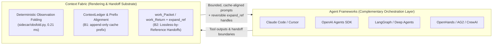

# Sub-Agent Handoff Landscape and Budgeted Multi-Agent Benchmarks

**Date:** 2026-10-19  
**Task:** W3 — Sub-Agent Context Handoff Mechanics & Multi-Agent Context Benchmarks (B1 + B2)  
**Status:** Primary-source research (all URLs opened and verified on `2026-10-19`; unverified metrics explicitly marked `"not verified"`, exploratory estimates marked `"exploratory"`).

---

## Executive Summary

1. **Two polar handoff paradigms dominate shipping agent tools—and both fail on long-horizon coding trajectories.** Every framework examined in Part 1 defaults to either **clean-slate task-prompt isolation** (Claude Code `Agent`, OpenHands `TaskToolSet`, LangChain/Deep Agents `mode: "isolated"`, Cursor Subagents, CrewAI `allow_delegation`, AG2 `Subagents`) or **full-transcript inheritance** (Claude Code `Agent(fork)` / `/subtask`, OpenAI Agents SDK default `handoff()`, LangGraph shared-channel subgraphs, Deep Agents `mode: "fork"`, AutoGen v0.4 `Swarm`). Clean-slate isolation drops parent-discovered file invariants, forces cold prompt caches on turn 1, and returns a lossy final text message; full-transcript inheritance carries parent tool-output noise into the child, risking immediate context overflow or mid-trajectory LLM compaction.
2. **In-flight context capping relies on lossy truncation, observation masking, or expensive LLM summarization calls.** Recent empirical evidence on SWE-bench Verified (`N=50` at a 16k usable-context budget, ReFold, arXiv:2610.07863) shows that tool-output-only pruning (`clip`, `mask`, `prune`, `recall`) still suffers **38%–86%** context-budget exceed rates because agent reasoning and commands consume **~41%** of peak KV cache, whereas threshold-triggered LLM compaction (`compact`) adds **~152 s** of latency (**4 calls × ~38 s**, **14%** of total task cost) and permanently loses **17%–48%** of observation tokens.
3. **Context Fabric is complementary to agent orchestration frameworks and directly addresses their structural handoff gap.** Rather than competing with LangGraph, OpenAI Agents SDK, Claude Code, or OpenHands as an agent loop, Context Fabric operates at the **context rendering and handoff substrate**: deterministic observation folding (`obsfold`, `0.21 ms` mean latency in B8) + `ContextLedger` (B1) + `work_Packet` / `work_Return` with `expand_ref` pointers (B2). It gives sub-agents a third option between "blind clean-slate" and "bloated full-transcript fork": a **bounded, cache-aligned, lossless-by-reference handoff packet**.
4. **Next benchmark recommendation after B8:** Adopt **Terminal-Bench 2.1** (89 containerized CLI tasks, or its 50-task stratified subset following ReFold) as the **primary next benchmark after B8**, paired with **SWE-bench Pro** (public 11-repository long-horizon subset) as the secondary software-engineering stress test. Both run locally on WSL2 + Docker, evaluate hard multi-step trajectories where context caps bind, and naturally exercise a **Coordinator → Explorer / Bash-Runner / Patch-Verifier** sub-agent topology.

---

## PART 1: Sub-Agent Context Handoff Mechanics in Shipping Agent Tools

### 1.1 Comparative Matrix Across Shipping Frameworks

| System / Framework | Spawn / Handoff Primitive | What Context the Sub-Agent Receives | How Context Is Capped or Condensed During Work | What Returns to the Parent | Known Failure Modes (Overflow, Lost Context, Cache) | Published Numbers (Verified from Opened Sources) |
| :--- | :--- | :--- | :--- | :--- | :--- | :--- |
| **Claude Code Subagents** (Anthropic) | `Agent` tool (non-fork isolated default) vs. `Agent(fork)` / `/subtask` (forked, default on since v2.1.302); `SendMessage` (`resume` by `agentId`) | **Non-fork:** Fresh context window; receives own system prompt + env info, task prompt, `CLAUDE.md`/`AGENTS.md` + git status (omitted for `Explore`/`Plan` or `omitClaudeMd: true`), preloaded `skills`, sibling roster. No parent history or `MEMORY.md`. **Fork:** Full parent conversation history, system prompt, tools, and model at spawn time (shares warm parent prompt cache on turn 1). | `maxTurns` turn cap (returns `partial`, resumable via `SendMessage`); `autoCompactWindow` (`100,000`–`1,000,000` tokens) or `CLAUDE_AUTOCOMPACT_PCT_OVERRIDE` triggers LLM `/compact` (~12% summary + reloads startup files + up to 5 recent files + skills capped at `5,000` tokens/skill, `25,000` total); max concurrency `20`, max spawn depth `3`; custom agent descriptions warn at `15,000` tokens. | Only the final text message + metadata trailer (token counts, duration, `agentId`), scanned for prompt-injection markers (`<system-reminder>`, `Human:`, `bypassPermissions`). Intermediate tool calls stay in `~/.claude/projects/.../subagents/agent-{agentId}.jsonl` (30-day retention). | **Non-fork:** Cold prompt cache on turn 1; parent omissions force redundant file re-discovery. **Fork:** Inherits bloated parent transcript; risks early auto-compaction (`preTokens: 167189` in docs); parallel worktree/checkout collisions if not isolated; lossy final text return. | **Docs walkthrough:** Subagent uses `9,890` tokens (`3,790` startup + `6,100` reads) and returns a **`420`-token** summary. **Anthropic Research blog:** Subagents compress `10,000+` token searches into **`1,000`–`2,000` token** returns; Opus 4 lead + Sonnet 4 subagents beat single-agent Opus 4 by **`+90.2%`**; multi-agent uses **`~15x`** chat tokens vs **`~4x`** single-agent; token usage explains **`80%`** of BrowseComp variance. |
| **OpenAI Agents SDK** (`openai-agents-python`) | **Peer Handoff:** `handoff(agent)` (`transfer_to_<agent>`) **Manager Tool:** `Agent.as_tool()` | **Handoff (default):** Entire prior conversation history (`input_history` + `pre_handoff_items` + `new_items`) + shared local Python `RunContextWrapper[T].context` (not sent to LLM). **Filtered / Nested Handoff:** `input_filter` (e.g., `remove_all_tools`) or `nest_handoff_history=True` (`<CONVERSATION HISTORY>` block). **`as_tool()`:** Only structured tool arguments in a fresh run + optional `RunContextWrapper[T]`. | `max_turns` per `Runner.run()`; no automatic mid-run token condenser in core SDK. Handoff boundary supports `handoff_filters.remove_all_tools` (strips `ToolCallItem`, `ToolCallOutputItem`, `HandoffCallItem`, `HandoffOutputItem`, `ReasoningItem`) or `nest_handoff_history=True` (collapses prior messages into one assistant transcript summary and drops raw `function_call`, `function_call_output`, and `reasoning` items). | **Handoff:** Control transfers permanently unless new agent executes another handoff back. **`as_tool()`:** Returns final string output (`result.final_output`) as a `ToolCallOutputItem` to the manager agent. | **Unfiltered handoff:** Full tool output bloat carries over; duplicate tool invocations; orphaned `ReasoningItem` errors across models. **`remove_all_tools` / `nest_handoff_history`:** Strips all tool outputs (`function_call_output`), forcing downstream agent to re-read files or trust unverified assistant claims. | Quantitative token-saving or benchmark pass-rate numbers for `handoff_filters` / `nest_handoff_history`: **not verified** (none published in official SDK docs or source). |
| **LangGraph & LangChain Deep Agents** | **LangGraph:** `add_node(subgraph)` (shared keys), `subgraph.invoke()` in node (isolated schema), `Send(node, arg)` (map-reduce), `Command(goto=..., graph=Command.PARENT)` **Deep Agents:** `task(subagent_type, description)` (`mode: "isolated"` or `"fork"`), `AsyncSubAgent`, `CodeInterpreterMiddleware` dynamic `task()` | **LangGraph shared node:** Full shared state channels (e.g., `messages`). **LangGraph isolated node / `Send`:** Only mapped dict / `Send` payload. **Deep Agents `isolated` (default):** Task description string + own `system_prompt`, `tools`, `skills` + propagated immutable `runtime.context` + inherited `state_schema` (for dict specs). **Deep Agents `fork`:** Parent `messages` history (trailing `task` tool call replaced by continuation `HumanMessage`) + parent system prompt. | **LangGraph Core:** `recursion_limit` (default `1000` since v1.0.6) + `RemainingSteps` managed value; `DeltaChannel` linear checkpoints. **Deep Agents (`create_deep_agent`):** Built-in **Offloading** (tool inputs/results `> 20,000` tokens offloaded to virtual filesystem with 10-line preview; inputs truncated at `85%` window) + **`SummarizationMiddleware`** (triggers at `85%` of `max_input_tokens`, keeps `10%` recent tokens, or `170,000`-token fallback / `6` messages kept; writes canonical transcript to filesystem; retries on `ContextOverflowError`) + optional `compact_conversation` tool. | **Tool / Deep Agents `task`:** Final `AIMessage.content` (or structured JSON via `response_format`) wrapped in a `ToolMessage` to supervisor. **`Command.PARENT` handoff:** Explicit state `update` dict (must pair triggering `AIMessage` + acknowledging `ToolMessage` matching `tool_call_id`). **`Send`:** Worker output reduced into parent channel (e.g., `operator.add`). | **Subgraph handoffs:** Malformed conversation history if `AIMessage` tool call and `ToolMessage` response pair are not manually constructed; static `GetState(subgraphs=True)` cannot inspect tool-wrapped subagents. **Supervisor blindness:** Subagent runs tools and reasoning in isolated state but forgets to include key details in final message. **Fan-out overflow:** `Send` map-reduce without output bounding floods parent reducer channel. | **Configured thresholds (verified in docs):** `recursion_limit = 1000`; tool offloading threshold = **`20,000` tokens** (preview = **`10` lines**); auto-summarization trigger = **`85%`** of `max_input_tokens` (**`10%`** recent kept; fallback **`170,000` tokens** / **`6` messages**). Benchmark win-rate deltas: **not verified** in docs. |
| **OpenHands** (V0 `AgentDelegateAction` & V1 SDK `TaskToolSet`) | **V0:** `AgentDelegateAction(agent, inputs)` over `EventStream` **V1 SDK:** `TaskToolSet` (`task(prompt, subagent_type, description, resume)`), file-based agents (`.agents/agents/*.md`), `Conversation.fork()` | **V0 Delegation:** `inputs` dict + subtype event stream. **V1 `TaskToolSet`:** Fresh isolated `Conversation` with own event history, `system_prompt`, `tools`, `skills`, `model` (`"inherit"` or profile); sees only `prompt` (unless `resume="task_00000001"` reloads prior subagent trajectory from disk). **`Conversation.fork()`:** Deep copy of parent `events`, `agent` state, and activated skills; shared workspace. | Per-subagent `max_iteration_per_run` cap; **`LLMSummarizingCondenser`** (subclass of `RollingCondenser` in `openhands.sdk.context.condenser`): triggers when event count `> max_size` (e.g., `10` in SDK guide) or token limit, preserves first `keep_first` events (system prompt + initial user message) and recent tail, and replaces dropped middle events with an LLM-generated summary event. | **V0:** `AgentDelegateObservation(outputs, content)`. **V1 `TaskToolSet`:** `TaskObservation(task_id, subagent, status, text)` returning only the subagent's final response `text` and `task_id` (parent can pass `resume=task_id` to follow up). | **Blocking execution:** `TaskToolSet` blocks parent until subagent completes or hits `max_iteration_per_run`. **Lossy rolling condensation:** `LLMSummarizingCondenser` permanently replaces middle trajectory events with an LLM summary inside long subagent runs. **Shared workspace mutation:** `Conversation.fork()` and local subagents share the filesystem without copy-on-write isolation. | **ICLR 2025 paper (arXiv:2407.16741v3):** `CodeActAgent` v1.8 delegating to `BrowsingAgent` v1.0 achieves **`14.5%`** (`gpt-4o`) and **`15.3%`** (`claude-3-5-sonnet`) on WebArena (`N=812`) vs **`14.8%`** / **`15.5%`** standalone, and **`39.8%`** vs **`40.8%`** on MiniWoB++ (`N=125`). **SDK Condenser guide:** `LLMSummarizingCondenser` yields **up to `2x` reduction in per-turn API costs** with no SWE-bench degradation. |
| **Cursor & Windsurf** (IDE / Background Agents) | **Cursor:** `Task` tool (Foreground or Background `is_background: true`), built-in `Explore` & `Browser` subagents, `.cursor/agents/*.md`, Cloud Subagents (`/in-cloud` / `cursor.com/agents`) **Windsurf (Devin Desktop):** Legacy Cascade `/[workflow]` chaining, Rules, Memories (Note: legacy Cascade only; replaced by `Devin Local` Skills) | **Cursor Subagents:** Clean context window (no prior parent conversation history; receives only parent-supplied `Task` prompt + own system prompt + configured tools/MCP + model). **Cursor Cloud Agents:** Cloned git repo on isolated cloud VM/branch + `.cursor/environment.json` snapshot + prompt. **Windsurf Cascade:** Single shared trajectory (chaining `/workflow-2` injects markdown instructions into active session, not an isolated subagent window). | **Cursor:** Built-in `Explore` runs up to **`10` parallel searches** on a faster model and `Browser` filters noisy MCP DOM snapshots inside isolated windows; custom subagents support `model` context overrides (e.g. `context=300k`) and `readonly: true`. **Windsurf Cascade:** Hard file character caps: **`12,000` chars** per workflow file, **`12,000` chars** per workspace rule file, **`6,000` chars** for `global_rules.md`; rule activation modes (`always_on`, `model_decision`, `glob`, `manual`). | **Cursor Foreground:** Final summary message returned to parent upon completion. **Cursor Background:** Immediate launch confirmation + disk-persisted state (`resume` via agent ID). **Cursor Cloud Agent:** Branch commits + PR / status handoff. **Windsurf:** In-place trajectory continuation + workspace Memories (`~/.codeium/windsurf/memories/`). | **Cursor:** Context starvation if parent omits background from `Task` prompt; local subagents share the same git checkout by default (concurrent file edit collisions unless git worktrees or `/in-cloud` VMs are used); token cost multiplication across parallel subagents. **Windsurf:** No subagent context isolation in Cascade workflows; rule/workflow files silently truncated or rejected above `6,000` / `12,000` chars. | **Cursor docs:** `Explore` subagent executes up to **`10` parallel searches**; custom model string example `claude-opus-5[effort=high,context=300k]`. **Windsurf docs:** **`12,000`-character** limit per workflow and workspace rule; **`6,000`-character** limit for `global_rules.md`. Pass-rate or token-saving benchmarks: **not verified** (none published in official docs). |
| **AutoGen / AG2 & CrewAI** | **AutoGen v0.4:** `Swarm` (`HandoffMessage(target, context)`) **AG2 (`ag2`):** Tool-called `Subagents` (isolated stream), `agent.resume(events)` **CrewAI:** `Task(context=[...])` sequential/explicit chain; `allow_delegation=True` (`Delegate work to coworker` / `Ask question to coworker`) | **AutoGen v0.4 `Swarm`:** Shared group-chat `_message_thread` + `HandoffMessage.context` list. **AG2 `Subagents`:** Isolated stream per delegated tool call + `Conversation Variables` / `Depends`. **CrewAI `Task(context=...)`:** Upstream `TaskOutput` (`raw`, `pydantic`, `json_dict`). **CrewAI Delegation:** Only `(task, context, coworker)` strings manually written by the delegating LLM + shared/scoped `Memory` (`/agent/<role>`). | **AutoGen v0.4 `Swarm`:** `max_turns` & `TerminationCondition`; optional `model_context` buffer (`BufferedChatCompletionContext`, not default). **AG2:** `Middleware` history trimming + on-demand `Skills` (`agentskills.io`). **CrewAI:** `respect_context_window=True` (default) auto-summarizes context when exceeding LLM window (`False` halts with error); `max_iter` (default `20`); hierarchical `Memory` recall weighted by `semantic_weight`, `recency_weight`, `importance_weight`. | **AutoGen `Swarm`:** Appends messages + `HandoffMessage` to shared thread. **AG2 `Subagents`:** Final reply (`reply.text` / structured output / `reply.files`) returned as tool result. **CrewAI:** `TaskOutput` object (`raw`, `pydantic`, `json_dict`) or string tool response from coworker. | **AutoGen `Swarm`:** Unbounded shared `_message_thread` grows across all participants; invalid `HandoffMessage.target` raises `ValueError` on resume. **CrewAI Delegation:** Coworker has zero access to parent history unless LLM manually types it into `context: str`; `respect_context_window=True` triggers opaque lossy summarization over upstream `TaskOutput` blobs. | **CrewAI docs:** Default `respect_context_window=True`, default `max_iter=20` (15–25 range in docs examples). Quantitative multi-agent token compression benchmarks in official AutoGen/AG2/CrewAI docs: **not verified**. |

---

### 1.2 Deep-Dive by Shipping System

#### 1. Claude Code Subagents (Anthropic)
* **Primary Sources Opened:**
  * `https://code.claude.com/docs/en/sub-agents.md` (accessed 2026-10-19)
  * `https://code.claude.com/docs/en/context-window.md` (accessed 2026-10-19)
  * `https://code.claude.com/docs/en/prompt-caching.md` (accessed 2026-10-19)
  * `https://www.anthropic.com/engineering/built-multi-agent-research-system` (accessed 2026-10-19)
  * `https://www.anthropic.com/engineering/effective-context-engineering-for-ai-agents` (accessed 2026-10-19)
* **What Context a Spawned Sub-Agent Receives:**
  * **Isolated Mode (`Agent` tool non-fork):** Spawns a fresh context window. The sub-agent receives its own system prompt (plus basic environment metadata), the parent's delegation task prompt, project `CLAUDE.md` / `AGENTS.md` and git status (omitted by default for built-in `Explore` and `Plan` sub-agents to save tokens, or when `omitClaudeMd: true` is set in agent frontmatter), any frontmatter `skills` preloaded in full, and a roster of sibling agents. It **never** receives the parent's conversation history, parent `MEMORY.md`, or prior tool outputs, and it starts with a **cold prompt cache** on turn 1 (`subagentPromptCacheTtl` defaults to the `5m` bucket even when the parent session uses `1h`).
  * **Fork Mode (`/subtask` or `Agent` with `fork`, default on since v2.1.302):** Inherits the **entire parent conversation history**, system prompt, tool definitions, and model at the moment of spawn. Because the prefix matches the parent session byte-for-byte, the sub-agent's first turn reads directly from the parent's warm prompt cache.
* **How Context Is Capped or Condensed During Work:**
  * **Turn & Topology Caps:** `maxTurns` caps agentic iterations inside the sub-agent (returning status `partial` when exhausted, which the parent can resume via `SendMessage` using `agentId`). Concurrency is capped at `CLAUDE_CODE_MAX_CONCURRENT_SUBAGENTS=20`, nesting depth at `CLAUDE_CODE_MAX_SUBAGENT_SPAWN_DEPTH=3`, and combined custom agent descriptions warn at `15,000` tokens.
  * **Auto-Compaction (`autoCompactWindow`):** Each sub-agent has an independent context window and can set `autoCompactWindow` (`100,000` to `1,000,000` tokens) or inherit `CLAUDE_AUTOCOMPACT_PCT_OVERRIDE`. When triggered (the docs show a concrete hook payload with `preTokens: 167189`), `/compact` summarizes prior conversation history to roughly **12%** of its pre-compaction size, reloads startup files (`CLAUDE.md`, `MEMORY.md`, git status), re-attaches up to the **5 most recently modified files** the agent worked with, and re-attaches invoked skills capped at **`5,000` tokens per skill** (**`25,000` tokens** combined).
* **What Returns to the Parent:**
  * Only the sub-agent's **final text message** plus a lightweight metadata trailer (token counts, duration, and `agentId`). All intermediate file reads and bash outputs remain quarantined in `~/.claude/projects/{project}/{sessionId}/subagents/agent-{agentId}.jsonl` (retained for 30 days). Before entering the parent context, the returned text is scanned for prompt-injection and instruction-shaped patterns (`<system-reminder>`, `Human:` role prefixes, `bypassPermissions`).
* **Known Failure Modes:**
  * **Cold-Cache vs. Bloated-Prefix Dilemma:** Non-fork sub-agents pay full uncached input token cost on turn 1 and must re-discover files if the parent's task string was underspecified; forked sub-agents get a warm cache on turn 1 but inherit all of the parent's prior tool-output noise, pushing the child closer to `autoCompactWindow`.
  * **Lossy Final-Message Bottleneck:** Because only the final text message returns to the parent, any line numbers, exact stack traces, or subtle invariants the sub-agent omitted from its prose summary are inaccessible to the parent without either re-reading the files or calling `SendMessage` to resume the sub-agent.
* **Published Numbers:**
  * In the official `context-window.md` walkthrough, delegating an auth-flow trace to a sub-agent consumes **`9,890` tokens** inside the sub-agent (`3,790` startup + `6,100` across three file reads) while adding only a **`420`-token** summary to the parent's context window (**95.8% reduction** in parent context footprint).
  * In Anthropic's multi-agent research engineering post (`built-multi-agent-research-system`), sub-agents condense `10,000+` tokens of web/tool searches into **`1,000`–`2,000` token** handoffs; a multi-agent system with Claude Opus 4 lead + Claude Sonnet 4 sub-agents outperformed single-agent Claude Opus 4 by **`+90.2%`** on internal research evaluations; multi-agent architectures consumed **`~15x` more tokens** than standard chat interactions (vs **`~4x`** for single agents); and across BrowseComp, **token usage alone explained `80%` of performance variance** (with tool call count and model choice explaining another `15%`).

#### 2. OpenAI Agents SDK (`openai-agents-python`)
* **Primary Sources Opened:**
  * `https://raw.githubusercontent.com/openai/openai-agents-python/main/docs/handoffs.md` (accessed 2026-10-19)
  * `https://raw.githubusercontent.com/openai/openai-agents-python/main/docs/agents.md` (accessed 2026-10-19)
  * `https://raw.githubusercontent.com/openai/openai-agents-python/main/docs/context.md` (accessed 2026-10-19)
  * `https://raw.githubusercontent.com/openai/openai-agents-python/main/docs/multi_agent.md` (accessed 2026-10-19)
  * `https://raw.githubusercontent.com/openai/openai-agents-python/main/src/agents/extensions/handoff_filters.py` (accessed 2026-10-19)
  * `https://raw.githubusercontent.com/openai/openai-agents-python/main/src/agents/handoffs/__init__.py` (accessed 2026-10-19)
  * `https://raw.githubusercontent.com/openai/openai-agents-python/main/src/agents/handoffs/history.py` (accessed 2026-10-19)
* **What Context a Spawned Sub-Agent Receives:**
  * **Decentralized Handoffs (`handoff(agent)`):** Exposed to the LLM as a tool named `transfer_to_<agent_name>`. By default, when a handoff occurs, the receiving agent inherits the **entire prior conversation history** (`HandoffInputData(input_history, pre_handoff_items, new_items, run_context)`), plus the shared local dependency object `RunContextWrapper[T].context` (which is passed to Python tools/hooks but never serialized into the LLM prompt).
  * **Manager Pattern (`Agent.as_tool()`):** The parent retains control and invokes the specialist as a tool. The specialist runs in a fresh session seeing **only the structured tool call arguments** (plus `RunContextWrapper[T]` if shared) and none of the manager's message history.
* **How Context Is Capped or Condensed During Work:**
  * **No Built-in Mid-Run Condenser:** Within a single agent loop, only `max_turns` caps execution.
  * **Handoff Boundary Filters (`input_filter` & `nest_handoff_history`):** At the handoff boundary, developers can attach an `input_filter: Callable[[HandoffInputData], HandoffInputData]`.
    * `agents.extensions.handoff_filters.remove_all_tools` (`src/agents/extensions/handoff_filters.py`) strips every `HandoffCallItem`, `HandoffOutputItem`, `ToolCallItem`, `ToolCallOutputItem`, and `ReasoningItem` from `input_history`, `pre_handoff_items`, and `new_items`.
    * `RunConfig(nest_handoff_history=True)` (implemented in `src/agents/handoffs/history.py` via `nest_handoff_history()`) collapses prior conversation turns into a single assistant message wrapped in `<CONVERSATION HISTORY>...</CONVERSATION HISTORY>` tags while **dropping all `function_call`, `function_call_output`, and `reasoning` items** from the nested block so tool calls are not duplicated or re-sent without matching pairs.
* **What Returns to the Parent:**
  * In a `handoff()`, control does **not** automatically return to the parent; the receiving agent becomes the active speaker until termination or an explicit reverse handoff tool call.
  * In `Agent.as_tool()`, only `result.final_output` (a string or serialized output schema) returns to the parent manager as a `ToolCallOutputItem`.
* **Known Failure Modes:**
  * **All-or-Nothing Tool History:** Leaving default handoffs unfiltered passes every raw tool output across agent boundaries, rapidly overflowing downstream windows and invalidating prompt caches (because the system prompt swaps to the new agent). Enabling `remove_all_tools` or `nest_handoff_history=True` deletes all `function_call_output` items, so the receiving agent sees assistant claims without any of the underlying tool observations.
  * **Orphaned Reasoning Items:** Passing `ReasoningItem` objects across handoffs between different models or system prompts causes API validation errors unless filtered (explicitly handled in `history.py` and `remove_all_tools`).
* **Published Numbers:**
  * Quantitative token-reduction or benchmark accuracy numbers for `handoff_filters` or `nest_handoff_history`: **not verified** (no quantitative benchmarks are published in the `openai-agents-python` documentation or source repository).

#### 3. LangGraph (Subgraphs, `Send`) and LangChain Deep Agents
* **Primary Sources Opened:**
  * `https://docs.langchain.com/oss/python/langgraph/use-subgraphs.md` (accessed 2026-10-19)
  * `https://docs.langchain.com/oss/python/langgraph/graph-api.md` (accessed 2026-10-19)
  * `https://docs.langchain.com/oss/python/langchain/multi-agent/subagents.md` (accessed 2026-10-19)
  * `https://docs.langchain.com/oss/python/langchain/multi-agent/handoffs.md` (accessed 2026-10-19)
  * `https://docs.langchain.com/oss/python/deepagents/subagents.md` (accessed 2026-10-19)
  * `https://docs.langchain.com/oss/python/deepagents/context-engineering.md` (accessed 2026-10-19)
  * `https://raw.githubusercontent.com/langchain-ai/deepagents/main/README.md` (accessed 2026-10-19)
* **What Context a Spawned Sub-Agent Receives:**
  * **LangGraph Subgraphs (`use-subgraphs.md`):** Supports two structural patterns:
    1. **Add compiled subgraph as a node (`builder.add_node("child", subgraph)`):** Parent and subgraph **share state keys** (such as `messages`). The subgraph reads and mutates the parent's message channel directly.
    2. **Invoke subgraph inside a node or tool (`subgraph.invoke(...)`):** Parent and subgraph have **disjoint state schemas**. A Python wrapper maps parent state into subgraph input (e.g., passing only `query: str` or a filtered slice of `runtime.state["messages"]`).
  * **LangGraph `Send(node, state_dict)` (`graph-api.md`):** Dynamic map-reduce fan-out from conditional edges. Spawns $N$ parallel super-step executions of `node`, each receiving its own custom `state_dict` payload (isolated from sibling workers).
  * **Deep Agents (`deepagents/subagents.md`):** Exposes a built-in `task(subagent_type, description)` tool (plus beta dynamic code-interpreter `task()` dispatch via `CodeInterpreterMiddleware` / `langchain-quickjs`). Subagents support two context modes:
    * `mode: "isolated"` (default): Receives only the `description` string as a `HumanMessage`, its own `system_prompt`, `tools`, and `skills`, plus propagated immutable `runtime.context` and (for dictionary-defined subagents) the parent's `state_schema`.
    * `mode: "fork"`: Inherits the parent's full `messages` history (with the trailing `task` tool call replaced by `HumanMessage("Continuing as the subagent that was just invoked. <description>")`) and parent system prompt to reuse the parent's prompt cache prefix. Forked subagents cannot call `task` recursively.
* **How Context Is Capped or Condensed During Work:**
  * **LangGraph Core:** Caps super-steps via `recursion_limit` (default **`1000`** since v1.0.6) and exposes `RemainingSteps` so nodes can route to a fallback summarizer when `remaining_steps <= 2`. `DeepAgentState` uses `DeltaChannel` on `messages` so checkpoint growth stays linear.
  * **Deep Agents Built-in Context Compression (`deepagents/context-engineering.md`):** Automatically attaches two compression stages to every agent and synchronous subagent:
    1. **Filesystem Offloading (`FilesystemMiddleware`):** When a tool call result exceeds **`20,000` tokens**, the full output is written to the virtual filesystem backend (`StateBackend`, disk, or sandbox) and replaced in-context with a file path reference + a **preview of the first `10` lines**. When session context crosses **`85%`** of the model's window, older file-write/edit tool call **inputs** exceeding **`20,000` tokens** are also truncated to file pointers.
    2. **Automatic Summarization (`SummarizationMiddleware`):** When context crosses **`85%`** of `max_input_tokens` (or **`170,000` tokens** if no model profile exists, or immediately on `ContextOverflowError`) and nothing else can be offloaded, an LLM call generates a structured summary (session intent, artifacts created, next steps) while keeping **`10%` of tokens** (or **`6` messages** in fallback mode) as recent context, and writes the full raw message transcript to the filesystem for search recovery. Agents can also invoke on-demand compaction via `compact_conversation` (`create_summarization_tool_middleware`).
* **What Returns to the Parent:**
  * **Subagent Tool / Deep Agents `task`:** Only `result["messages"][-1].content` (or structured JSON when `response_format` is set) returns as a `ToolMessage` to the supervisor.
  * **Subgraph `Command(goto=..., graph=Command.PARENT)`:** Returns an explicit `update` dictionary to the parent graph. As `handoffs.md` warns, the update **must** include both the triggering `AIMessage` (with the tool call) and a matching `ToolMessage` (`tool_call_id=runtime.tool_call_id`) or the parent conversation history becomes malformed.
  * **`Send` Fan-In:** Each parallel worker returns a partial state update that is merged into the parent state channel via a declared reducer (e.g., `Annotated[list, operator.add]`).
* **Known Failure Modes:**
  * **Supervisor Final-Message Blindness (`subagents.md`):** A documented failure mode where the sub-agent performs multi-step tool calls and reasoning in its isolated context but omits key evidence from its final message, leaving the supervisor unable to act without re-invoking.
  * **Malformed Handoff Transcripts (`handoffs.md`):** In multi-subgraph handoffs via `Command.PARENT`, omitting the paired `AIMessage` + `ToolMessage` or having parallel tool calls active during a handoff corrupts the message sequence and triggers LLM provider errors.
  * **Opaque State Inspection (`subagents.md`):** Because tool-wrapped subagents run inside Python tool functions, LangGraph cannot statically discover them, so `graph.get_state(config, subgraphs=True)` cannot inspect their internal state during interrupts.
* **Published Numbers:**
  * Verified configuration constants from `graph-api.md` and `deepagents/context-engineering.md`: `recursion_limit = 1000` (default since v1.0.6); tool input/output offloading threshold = **`20,000` tokens** with a **`10`-line** preview; summarization trigger = **`85%`** of `max_input_tokens` retaining **`10%`** recent tokens (fallback trigger = **`170,000` tokens** retaining **`6` messages**). Empirical benchmark pass-rate improvements from Deep Agents offloading/summarization: **not verified** (none published in the docs).

#### 4. OpenHands (Delegation & Condensers)
* **Primary Sources Opened:**
  * `https://arxiv.org/abs/2407.16741` & `https://arxiv.org/html/2407.16741v3` (OpenHands ICLR 2025 paper, accessed 2026-10-19)
  * `https://docs.openhands.dev/sdk/guides/context-condenser.md` (accessed 2026-10-19)
  * `https://docs.openhands.dev/sdk/guides/task-tool-set.md` (accessed 2026-10-19)
  * `https://docs.openhands.dev/sdk/guides/agent-file-based.md` (accessed 2026-10-19)
  * `https://docs.openhands.dev/sdk/guides/convo-fork.md` (accessed 2026-10-19)
  * `https://docs.all-hands.dev/llms.txt` (accessed 2026-10-19)
* **What Context a Spawned Sub-Agent Receives:**
  * **V0 Architecture (`AgentDelegateAction`, arXiv:2407.16741v3):** A generalist agent (`CodeActAgent` v1.8) emits an `AgentDelegateAction(agent="BrowsingAgent", inputs={...})` on the shared `EventStream` to invoke a specialist sub-agent (`BrowsingAgent` v1.0) for a subtask.
  * **V1 SDK Sub-Agent Delegation (`TaskToolSet` in `openhands.tools.task`, `task-tool-set.md` & `agent-file-based.md`):** Exposes a synchronous blocking `task(prompt, subagent_type, description, resume)` tool. Each delegated task spawns an isolated sub-agent `Conversation` with its own independent event history, `system_prompt`, `tools`, `skills`, and `model` (`"inherit"` or a named LLM profile). The sub-agent receives **only the `prompt` string** (none of the parent's conversation history), unless the parent passes `resume="task_00000001"`, which reloads that sub-agent's persisted event log from disk to continue a multi-turn sub-dialog. Built-in presets (`openhands/tools/preset/subagents/`) include `general-purpose`, `code-explorer` (read-only terminal), `bash-runner` (runs noisy test/build suites and returns concise summaries instead of raw logs), and `web-researcher`.
  * **Conversation Forking (`Conversation.fork()`, `convo-fork.md`):** Programmatic Python API that deep-copies all existing `events`, `agent` state, and activated skills into a new `Conversation` ID while keeping the source conversation untouched and sharing the underlying filesystem workspace.
* **How Context Is Capped or Condensed During Work:**
  * **Iteration Cap:** Each sub-agent configures `max_iteration_per_run` in its markdown frontmatter (`.agents/agents/*.md` or `.openhands/agents/*.md`) or `AgentDefinition`.
  * **Context Condensers (`LLMSummarizingCondenser`, `context-condenser.md`):** OpenHands attaches a `Condenser` (subclass of `RollingCondenser` in `openhands.sdk.context.condenser`) to an `Agent`. When the event stream length exceeds `max_size` (e.g., `max_size=10` in the SDK guide), `LLMSummarizingCondenser` preserves the first `keep_first` events (e.g., `keep_first=2`, keeping the system prompt and initial user task) plus the most recent events, and replaces the dropped middle trajectory segment with a single LLM-generated summary event.
* **What Returns to the Parent:**
  * In V1 `TaskToolSet`, completion returns a `TaskObservation(task_id, subagent, status, text)` containing **only the sub-agent's final response `text`** and its `task_id` (e.g., `task_00000001`). All intermediate bash outputs and file reads stay inside the sub-agent's persisted sub-conversation on disk.
* **Known Failure Modes:**
  * **Synchronous Parent Stalls:** `TaskToolSet` is strictly blocking; the parent agent cannot perform parallel work or monitor intermediate progress while a sub-agent runs up to `max_iteration_per_run`.
  * **Irreversible Middle-Event Loss in `LLMSummarizingCondenser`:** Once middle events are condensed into an LLM summary event, exact line numbers, diffs, or command outputs from those turns are no longer in the active event view unless the agent re-executes commands in the container.
  * **Shared Workspace Race Conditions:** Both `TaskToolSet` sub-agents and `Conversation.fork()` share the same container workspace directory without filesystem snapshot isolation.
* **Published Numbers:**
  * **OpenHands ICLR 2025 paper (arXiv:2407.16741v3, Section 3.4 Table):** On WebArena (`N=812`), `CodeActAgent` v1.8 delegating browsing subtasks to `BrowsingAgent` v1.0 achieved **`14.5%`** task success with `gpt-4o-2024-05-13` and **`15.3%`** with `claude-3-5-sonnet-20240620`, matching standalone `BrowsingAgent` (**`14.8%`** and **`15.5%`**) and beating standalone `CodeActAgent` without delegation (`5.0%` / `4.9%`). On MiniWoB++ (`N=125`), `CodeActAgent` with delegation achieved **`39.8%`** (`gpt-4o`) vs **`40.8%`** standalone `BrowsingAgent`.
  * **OpenHands SDK Condenser Guide (`context-condenser.md`):** Reports that `LLMSummarizingCondenser` is the default condenser for coding agents because it *"consistently performs as well or better than other condensers on SWE-bench while providing up to a **2x reduction in per-turn API costs**."*

#### 5. Cursor and Windsurf (Background Agents & IDE Subagents)
* **Primary Sources Opened:**
  * `https://cursor.com/docs/context/subagents` (accessed 2026-10-19)
  * `https://cursor.com/docs/background-agent` (canonical redirect `https://cursor.com/docs/cloud-agent`, accessed 2026-10-19)
  * `https://docs.windsurf.com/windsurf/cascade/memories.md` & `https://docs.devin.ai/desktop/cascade/memories.md` (accessed 2026-10-19)
  * `https://docs.windsurf.com/windsurf/cascade/workflows.md` & `https://docs.devin.ai/desktop/cascade/workflows.md` (accessed 2026-10-19)
* **What Context a Spawned Sub-Agent Receives:**
  * **Cursor Subagents (`cursor.com/docs/context/subagents`):** Each sub-agent starts with a **clean context window** and has **no automatic access to the parent conversation history**. It receives only the explicit context the parent includes in its `Task` tool prompt, its own markdown system prompt (`.cursor/agents/*.md`, also discovering `.claude/agents/` and `.codex/agents/`), its configured tools/MCP servers, and its model selection (`model: inherit`, `fast`, or an explicit model ID).
  * **Cursor Cloud / Background Agents (`cursor.com/docs/background-agent`):** Triggered via `/in-cloud` (when the parent delegates to a Cloud Subagent in a remote sandbox), `cursor.com/agents`, Slack, GitHub, or Linear. The cloud agent receives a fresh VM container cloned from the repository's git branch, hydrated via `.cursor/environment.json` (or a pre-warmed container snapshot), plus the task prompt.
  * **Windsurf / Devin Desktop (`memories.md` & `workflows.md`):** Legacy Cascade does **not** spawn isolated sub-agent context windows; instead, it chains markdown **Workflows** (`.devin/workflows/*.md` or `.windsurf/workflows/*.md`, invoked via `/[workflow-name]`, which can chain `/workflow-2`), **Rules** (`.devin/rules/*.md`), and auto-generated workspace-scoped **Memories** (`~/.codeium/windsurf/memories/`) inside a single shared trajectory. *(Note: The official Windsurf/Devin Desktop docs explicitly note that Cascade Memories and Workflows apply only to legacy Cascade and not to the newer default `Devin Local` agent, which uses Skills.)*
* **How Context Is Capped or Condensed During Work:**
  * **Cursor Built-in Context-Quarantine Subagents:** Cursor's documentation states that its two built-in sub-agents were created specifically *"after analyzing conversations that hit context window limits"*:
    1. **Explore Subagent:** Uses a faster model to run **up to `10` parallel searches** across the codebase, absorbing massive grep/file-read outputs in its own disposable window and returning only relevant findings.
    2. **Browser Subagent:** Controls the browser via MCP tools and filters noisy DOM snapshots and screenshots inside its own context window before returning distilled observations.
  * **Cursor Custom Model & Read-Only Caps:** Custom sub-agents can specify per-agent context window overrides in frontmatter (e.g., `model: claude-opus-5[effort=high,context=300k]`) and `readonly: true` to prevent file mutations.
  * **Windsurf Hard Character Caps:** Windsurf enforces strict character limits on injected context files: **`12,000` characters** per workflow file, **`12,000` characters** per workspace rule file, and **`6,000` characters** for `global_rules.md`.
* **What Returns to the Parent:**
  * **Cursor Foreground Subagent:** Blocks the parent and returns a single final summary message once complete.
  * **Cursor Background Subagent (`is_background: true`):** Returns immediately on launch; writes state files to disk as it works; can be resumed with its agent ID to continue with preserved sub-agent context.
  * **Cursor Cloud Subagent (`/in-cloud`):** Runs in an isolated cloud sandbox on its own git branch, summarizes its changes back to the parent session, and opens or updates a branch/PR.
* **Known Failure Modes:**
  * **Context Starvation on Delegation (`cursor.com/docs/context/subagents`):** Because Cursor sub-agents start with a clean window, omitting architectural constraints or prior debugging steps from the parent's `Task` prompt causes the sub-agent to repeat failed hypotheses.
  * **Concurrent Git Checkout Collisions:** Cursor's docs explicitly warn that local sub-agents share the same git checkout by default; running parallel background sub-agents that edit overlapping files causes race conditions unless the user sets up separate project copies / git worktrees or delegates via `/in-cloud`.
  * **Linear Token Multiplication:** Cursor notes that spawning multiple sub-agents multiplies API token consumption because each sub-agent maintains its own system prompt and tool-call loop.
* **Published Numbers:**
  * Verified from `cursor.com/docs/context/subagents` and `docs.devin.ai/desktop/cascade/`: up to **`10` parallel searches** in Cursor's `Explore` sub-agent; `300k` context override syntax (`claude-opus-5[effort=high,context=300k]`); **`12,000`-character** limit per Windsurf workflow/workspace rule and **`6,000`-character** limit for `global_rules.md`. Empirical benchmark pass rates or token-reduction percentages: **not verified** (none published in official docs).

#### 6. AutoGen / AG2 and CrewAI
* **Primary Sources Opened:**
  * `https://microsoft.github.io/autogen/stable/user-guide/agentchat-user-guide/swarm.html` (accessed 2026-10-19)
  * `https://raw.githubusercontent.com/microsoft/autogen/main/python/packages/autogen-agentchat/src/autogen_agentchat/teams/_group_chat/_swarm_group_chat.py` (accessed 2026-10-19)
  * `https://raw.githubusercontent.com/ag2ai/ag2/main/README.md` (accessed 2026-10-19)
  * `https://docs.ag2.ai/llms.txt` (accessed 2026-10-19)
  * `https://docs.ag2.ai/docs/user-guide/subagents/` (accessed 2026-10-19)
  * `https://docs.crewai.com/en/concepts/tasks.md` (accessed 2026-10-19)
  * `https://docs.crewai.com/en/concepts/collaboration.md` (accessed 2026-10-19)
  * `https://docs.crewai.com/en/concepts/memory.md` (accessed 2026-10-19)
* **What Context a Spawned Sub-Agent Receives:**
  * **Microsoft AutoGen v0.4 (`autogen-agentchat` `Swarm`):** All participants in a `Swarm` team share a **single group-chat `_message_thread`** managed by `SwarmGroupChatManager` (`_swarm_group_chat.py`). When an agent returns a `HandoffMessage(target="...", content="...", context=[...])`, the entire shared message thread (plus any attached `HandoffMessage.context` messages) is visible to the next speaker unless individual agents wrap their model client in a `BufferedChatCompletionContext`.
  * **AG2 (`ag2`, `docs.ag2.ai/llms.txt`):** The modern `ag2` framework replaces classic `ConversableAgent`/`initiate_chat` with protocol-driven `Agent` loops and `Subagents` (`docs.ag2.ai/docs/user-guide/subagents/`), where a parent LLM delegates via tool calling and **each sub-task runs on its own isolated event stream** with independent state, plus optional shared `Conversation Variables` (`docs/user-guide/context/variables/`) and on-demand `Skills` (`agentskills.io`). `agent.resume(events)` re-enters a turn from a recorded event trajectory.
  * **CrewAI (`tasks.md`, `collaboration.md`, `memory.md`):**
    1. **Task Context Chaining (`Task(context=[prior_task])`):** In `Process.sequential` or explicit `context=[...]`, a downstream task receives the completed `TaskOutput` (`raw` string, `pydantic` model, or `json_dict`) of upstream tasks injected into its prompt.
    2. **Coworker Delegation (`allow_delegation=True`):** Automatically equips the agent with two tools: `Delegate work to coworker(task: str, context: str, coworker: str)` and `Ask question to coworker(question: str, context: str, coworker: str)`. The coworker receives **only the `task`/`question` and `context` strings manually generated by the delegating LLM**—it does not inherit the delegator's message history—plus any shared or scoped records retrieved from CrewAI's unified `Memory` (`memory.scope("/agent/...")`).
* **How Context Is Capped or Condensed During Work:**
  * **AutoGen v0.4:** Team-level `max_turns` and `TerminationCondition` (e.g., `HandoffTermination`, `MaxMessageTermination`, `TextMentionTermination`); optional per-agent `model_context` (`BufferedChatCompletionContext` or `HeadAndTailChatCompletionContext`).
  * **AG2:** Turn-level `Middleware` (`docs/user-guide/middleware/`) for history trimming and request mutation, plus progressive disclosure via `Skills`.
  * **CrewAI:** `respect_context_window=True` (enabled by default) automatically summarizes conversation history when it exceeds the LLM's context window limit (setting `respect_context_window=False` halts execution with a context-exceeded error instead of summarizing). Iteration loops are capped by `max_iter` (default **`20`**). Long-term recall in `Memory` ranks items via a composite score (`semantic_weight`, `recency_weight`, `importance_weight`, `recency_half_life_days`).
* **What Returns to the Parent:**
  * **AutoGen `Swarm`:** All messages and `HandoffMessage` events append directly to the shared `_message_thread`.
  * **AG2 `Subagents`:** The sub-agent's final reply (`reply.text`, structured Pydantic/dataclass output, or `reply.files`) returns as the tool execution result to the calling agent.
  * **CrewAI:** Either a `TaskOutput` object (`raw`, `pydantic`, `json_dict`) passed to the next `Task`, or a string response returned from the `Delegate work to coworker` tool call.
* **Known Failure Modes:**
  * **AutoGen `Swarm` Shared-Thread Bloat & Resume Desync:** Because every participant appends to `_message_thread`, long multi-agent handoff chains accumulate all prior agents' tool outputs. Furthermore, `_swarm_group_chat.py` (lines 58–78) raises a `ValueError` if a `Swarm` team is resumed after `HandoffTermination` without a valid participant `HandoffMessage.target`.
  * **CrewAI Manual-Context Bottleneck & Lossy Auto-Summarization:** In `Delegate work to coworker(task, context, coworker)`, the delegating LLM must copy-paste all necessary background into the `context: str` argument; any omitted file path or constraint is invisible to the coworker. Conversely, chaining multiple verbose `TaskOutput.raw` payloads via `Task(context=[...])` trips `respect_context_window=True`, triggering lossy whole-history LLM summarization.
* **Published Numbers:**
  * Verified from CrewAI documentation: default `respect_context_window=True`, default `max_iter=20`. Published multi-agent token-saving benchmarks in official AutoGen/AG2/CrewAI docs: **not verified**.

---

### 1.3 Where Context Fabric Fits: Complement vs. Compete

Across all six shipping ecosystems, sub-agent context management suffers from a fundamental **Handoff Trilemma**:
1. **Clean-slate isolation** (Claude Code non-fork `Agent`, OpenHands `TaskToolSet`, LangChain/Deep Agents `isolated`, Cursor Subagents, CrewAI delegation, AG2 `Subagents`) keeps the parent window clean but **starves the child of prior file reads/invariants**, starts with a **cold KV/prompt cache**, and **throws away all intermediate evidence** when returning a single prose summary to the parent.
2. **Full-transcript forking / shared history** (Claude Code `Agent(fork)`, OpenAI Agents SDK default `handoff()`, LangGraph shared `messages`, Deep Agents `fork`, AutoGen `Swarm`) preserves parent context and warm prefix caches on turn 1, but **exports parent tool-output bloat into every child**, accelerating context exhaustion and forcing expensive mid-run LLM compactions.
3. **In-flight condensers** (`autoCompactWindow`, `LLMSummarizingCondenser`, `SummarizationMiddleware`, `respect_context_window=True`) rely on **lossy LLM summarization calls** that add latency (`~38 s` per call in ReFold's measurements), cost extra tokens, break prefix-cache locality at compaction boundaries, and permanently discard `17%–48%` of observation tokens.

#### Complement vs. Compete Breakdown

| Layer / Mechanism | Relationship | Why & How Context Fabric Integrates |
| :--- | :--- | :--- |
| **Agent Loop & Routing Frameworks** (LangGraph, OpenAI Agents SDK, Claude Code, OpenHands, AG2, CrewAI) | **Complement** | Context Fabric is **not** a competing agent orchestration framework or IDE. It plugs beneath any ReAct/tool loop (via proxy sidecar, OpenAI-compatible middleware, `input_filter`, or LangGraph middleware) to manage the rendered context and handoff payloads. |
| **In-Trajectory Tool Output Bloat** (`LLMSummarizingCondenser`, `SummarizationMiddleware`, `autoCompactWindow`, SWE-Pruner, ReFold) | **Compete on mechanism / Complement as fast pre-filter** | Shipping tools wait until `75%–85%` of the window is full and then fire a slow, lossy LLM summarization call (or run a `0.6B` neural scorer like SWE-Pruner at `~150–400 ms`/call). Context Fabric's deterministic `obsfold` (`0.21 ms` mean latency in `docs/engineering/B8-TEST-DESIGN.md`, zero GPU/API calls) folds large pytest, traceback, diff, and search outputs immediately upon ingestion while keeping full content addressable. This delays or eliminates threshold compactions (`ReFold` shows delaying compaction cuts compaction calls by up to **92%** at 32k budget). |
| **Parent → Sub-Agent Spawn (`work_Packet` + `ContextLedger`, B1 + B2)** | **Complement (Solves the Clean-Slate vs. Full-Fork Dilemma)** | Instead of passing *nothing* (clean-slate) or *everything raw* (full fork), Context Fabric's `ContextLedger` (B1) + `work_Packet` (B2) lets a parent pass a **folded, prefix-aligned trajectory view** plus content-addressed `expand_ref` handles. In OpenAI Agents SDK, this drops directly into `handoff(agent, input_filter=cf_handoff_filter)`. In LangGraph / Deep Agents, it replaces `some_logic(query, runtime.state["messages"])` with a deterministic ledger view. |
| **Sub-Agent → Parent Return (`work_Return` + `expand_ref`, B2)** | **Complement (Eliminates Final-Message Blindness)** | Every shipping tool (`Agent`, `TaskToolSet`, `as_tool()`, `task()`) returns only an unstructured text summary, stranding the child's raw file reads and test logs in an isolated JSONL file or discarding them. With Context Fabric's `work_Return`, the child returns a compact structured summary **plus immutable `expand_ref` pointers** into the shared Content-Addressable Store (CAS). If the parent needs the exact traceback or diff from step 7 of the child's run, it dereferences the `expand_ref` handle in `O(1)` without re-spawning the sub-agent or re-running the test suite. |

---

## PART 2: Benchmarks for Multi-Agent and Long-Horizon Context Management

### 2.1 Why Look Beyond SWE-bench Verified?

In B8 (`docs/engineering/B8-TEST-DESIGN.md`), `SWE-bench Verified` (`N=50` stratified tasks under a `24,576`-token window cap) serves as our single-agent context-cap stress test. However, as documented in recent primary literature opened for this report (`ReFold` arXiv:2610.07863, `SWE-Bench Pro` arXiv:2509.16941, `Terminal-Bench` arXiv:2610.07863 / `tbench.ai`), SWE-bench Verified has three limitations when evaluating **B1 (ContextLedger) + B2 (Sub-Agent Handoffs)**:
1. **Short-to-medium horizon for frontier models:** On SWE-bench Verified, frontier models finish in a median of **18 steps** (Claude Opus 4.8 in ReFold Appendix D.1) to **50 steps** (Qwen3.6-27B in ReFold Table 1), often localized to a single Python file.
2. **Single-language, single-patch scope:** SWE-bench Verified is 100% Python and rarely requires coordinated multi-component exploration, build-system compilation, or polyglot debugging where delegating to specialized sub-agents (`code-explorer`, `bash-runner`, `test-verifier`) beats a single agent.
3. **Contamination & saturation:** Frontier models exceed 70%–80% on SWE-bench Verified, compressing the headroom available to measure statistically significant resolve-rate deltas from multi-agent handoff protocols.

### 2.2 Comparison of Candidate Benchmarks Beyond SWE-bench Verified

All benchmarks below were verified from primary papers or official repositories opened on `2026-10-19`. Cost estimates for a 50-task paired A/B evaluation (`100` trajectories total) are marked **exploratory** where derived from per-task token volumes reported in ReFold (arXiv:2610.07863) and SWE-Pruner (arXiv:2601.16746).

| Benchmark | Task Type & Domain | Dataset Size | Official Harness & Evaluator | Cost to Run (Local GPU vs. Hosted API) | Runs Locally on WSL2 + Docker? | Does a Sub-Agent Topology Fit? | Primary Source (Accessed `2026-10-19`) |
| :--- | :--- | :--- | :--- | :--- | :--- | :--- | :--- |
| **Terminal-Bench 2.1** (and **1.0**) | Hard, realistic command-line interface (CLI) tasks: compiling kernels/compilers (`compile-compcert`, `make-doom-for-mips`), polyglot C/Rust/Python debugging (`polyglot-c-py`, `polyglot-rust-c`), ML training/inference (`caffe-cifar-10`, `torch-tensor-parallelism`), system administration (`configure-git-webserver`), security (`crack-7z-hash`). | **89 tasks** in Terminal-Bench 2.0 / 2.1 (28 tasks revised in v2.1 so zero tasks are unsolvable); **50-task** stratified subset used in ReFold. | **Harbor Framework** (`harbor-framework/terminal-bench-2-1`) / `tb` CLI (`terminus-2`, `mini-swe-agent`, `Claude Code`, `Codex CLI`, `OpenHands`). Evaluates final container state via pytest test suites. | **Local GPU (vLLM):** `$0` API cost (~3–6 GPU-hrs per 50-task arm on 2× RTX 6000 Ada / A100). **Hosted API (exploratory):** ~`$8`–`$35` per 50-task arm on Qwen3.6 / GPT-5.4-mini; ~`$60`–`$150` on frontier Opus/GPT-5.4. | **Yes (Native).** Every task runs in a pinned pre-built Docker container image via Docker Compose / Harbor CLI; lightweight per-task images run cleanly on WSL2 + Docker Desktop/Engine. | **Strong Fit (High).** Tasks naturally decompose into **Lead Coordinator** + **Explorer Sub-Agent** (inspects system/build tree) + **Bash-Runner Sub-Agent** (absorbs 10,000+ char compiler/test logs in isolated context and returns concise status + `expand_ref`). | `https://raw.githubusercontent.com/laude-institute/terminal-bench/main/README.md` `https://www.tbench.ai/news/terminal-bench-2-1` `https://arxiv.org/html/2610.07863v1` |
| **SWE-bench Pro** (Public Set) | Long-horizon enterprise software engineering issues requiring hours-to-days of human engineer effort, multi-file patches, and substantial code modifications across business apps, B2B services, and dev tools. | **1,865 total problems** across 41 repos: **Public set (11 repos)** with open access, Held-out set (12 repos), Commercial set (18 proprietary repos). **50-task** stratified subset used in ReFold. | Official SWE-bench Dockerized container evaluator + `mini-swe-agent` / `SWE-agent` / `OpenHands`. | **Local GPU (vLLM):** `$0` API cost. **Hosted API (exploratory):** Longer trajectories than Verified (~1.5x–2.5x tokens/task); ~`$15`–`$50` per 50-task arm on open-weight APIs or ~`$100`–`$250` on frontier APIs. | **Yes (Public Set).** The 11-repository public partition ships with official Docker container definitions compatible with WSL2 + Docker (requires ~100–200 GB disk cache for images). | **Strong Fit (High).** Multi-file enterprise patches require cross-module localization (`Explore` sub-agents fanning out across directories) followed by coordinated implementation and test verification (`Bash-Runner` sub-agent). | `https://arxiv.org/abs/2509.16941` `https://arxiv.org/html/2610.07863v1` |
| **Multi-SWE-bench** | Multilingual repository-level issue resolving across **7 programming languages**: Java, TypeScript, JavaScript, Go, Rust, C, and C++. | **1,632 verified instances** (annotated by 68 experts from 2,456 candidates) + **4,723 RL instances** (`Multi-SWE-RL`). **50-task** stratified subset used in ReFold; Rust/Go/Java subsets used in SWE-Pruner. | Official Multi-SWE-bench Docker evaluator (`SWE-agent`, `OpenHands`, `Agentless`, `mini-swe-agent`). | **Local GPU (vLLM):** `$0` API cost. **Hosted API (exploratory):** ~`$12`–`$45` per 50-task arm on open-weight APIs (verbose Maven/Cargo/Go build & test outputs drive high input token counts). | **Yes, with high disk/RAM overhead.** Runs on WSL2 + Docker, but language toolchains (Java/Maven, Rust/Cargo, C++ toolchains) make container images large (often 5–15 GB each; recommend >=64 GB RAM / 300 GB disk). | **Moderate-to-Strong Fit (Medium-High).** Verbose compiled-language build logs (Cargo, Maven, GCC) and unfamiliar multi-directory layouts benefit strongly from a `bash-runner` sub-agent and `obsfold` log folding. | `https://arxiv.org/abs/2504.02605` `https://arxiv.org/html/2610.07863v1` `https://arxiv.org/html/2601.16746v1` |
| **SWE-QA** | Repository-level code question answering requiring multi-file code understanding, call-graph tracing, and architectural synthesis across large repos. | **576 high-quality QA pairs** across **11 diverse repositories** (plus a 48-question deeply analyzed subset across 3 repos in SWE-Pruner). | `OpenHands` (CodeAct) or `mini-swe-agent` + LLM-as-a-Judge (5-point rubric on Comprehensiveness, Readability, Correctness, Relevance). | **Low.** SWE-Pruner reports `118.5K` (`Claude Sonnet 4.5`) to `259.6K` (`Qwen3-Coder`) tokens per task (~`$2`–`$15` for the 48-task subset, plus judge API calls). | **Yes (Lightweight).** Requires only local git clones of the 11 target Python/open-source repos in a single container or WSL2 virtualenv; no per-task Docker image build required. | **Strong Fit for Read-Only Fan-Out (High for B2 Read Path).** Mirrors Anthropic's & Cursor's `Explore` sub-agent pattern: a lead agent fans out 3–5 read-only sub-agents across modules and synthesizes their `work_Return` packets. | `https://arxiv.org/abs/2509.14635` `https://arxiv.org/html/2601.16746v1` |
| **AppWorld** | Interactive multi-app agent coding & API orchestration across **9 day-to-day apps** (email, Spotify, Venmo, Amazon, file system, etc.) via **457 APIs** and **~100 database tables** populated with 106 simulated users. | **750 natural, diverse tasks** requiring interactive coding loops (~50 lines of code, ~17 API calls, ~10 DB tables per task). | `appworld` Python package (`pip install appworld`) with fast in-memory/SQLite state snapshots and programmatic state-based unit tests (plus programmatic collateral-damage checks). | **Very Low.** Fast local execution (no heavy container compilation); 100-task sample costs ~`$5`–`$25` on mid-tier APIs or `$0` on local vLLM. | **Yes (Native Python / Docker optional).** Runs directly in WSL2 Python/uv or a single lightweight Docker container with millisecond environment resets. | **Moderate Fit (Medium).** Multi-app workflows (e.g., read emails + split Venmo bill + update calendar) can delegate per-app sub-agents, though trajectories are shorter than repo-level SWE/CLI tasks. | `https://arxiv.org/abs/2407.18901` |
| **τ-bench (Tau-bench)** | Multi-turn tool-agent-user interaction in **τ-retail** (358 lines of policy, 15 tools) and **τ-airline** (192 lines of policy, 13 tools) with an LLM-simulated human user and database state verification. | **165 tasks** (`115` in τ-retail, `50` in τ-airline); typically run `pass^k` (`k=1..8`) to measure reliability. | `tau-bench` Python harness (`sierra-research/tau-bench`); deterministic DB state comparison at end of dialog. | **Low-to-Moderate** (`165` tasks × `k` trials, plus LLM user-simulator calls; ~`$10`–`$40` per pass^1 sweep on hosted APIs). | **Yes (Pure Python).** No Docker containers required; runs in-process in WSL2. | **Canonical Fit for Peer Handoffs (Medium).** Directly models customer-support triage → specialist handoffs (OpenAI Agents SDK / LangGraph `handoffs.md` canonical use case), but tool outputs are small JSON objects rather than 10k-token logs. | `https://arxiv.org/abs/2406.12045` |

### 2.3 Published Context-Budget & Multi-Benchmark Numbers from Opened Sources

To anchor our benchmark selection in verified empirical data, Table 2.3 summarizes the multi-benchmark context management measurements from **ReFold** (`https://arxiv.org/html/2610.07863v1`, accessed `2026-10-19`) and **SWE-Pruner** (`https://arxiv.org/html/2601.16746v1`, accessed `2026-10-19`):

1. **Five-Benchmark Validation Under Fixed Harness (ReFold, arXiv:2610.07863v1, Section 4.1–4.3 & Appendix A–F):**
   * Evaluates **50 stratified tasks each** from **SWE-bench Verified**, **SWE-bench Pro**, **Multi-SWE-bench**, **Terminal-Bench 1.0**, and **Terminal-Bench 2.1** in `mini-swe-agent` (250-step limit, 10,000-char command truncation, temperature 0) on `Qwen3.6-27B` and `Qwen3.6-35B-A3B` served via vLLM on 2× NVIDIA RTX 6000 Ada GPUs.
   * **Why tool-output-only pruning fails strict context caps (Section 2, Observation 1):** On 50 SWE-bench Verified tasks at a **16k usable-context budget**, tool outputs account for **59%** of peak KV cache under `base` and agent messages/system prompt account for **41%**. Tool-only strategies (`clip`, `mask`, `prune`, `recall`) still hit **38%–86%** context-budget exceed rates (peak KV cache `0.89–0.98 GiB` against the `1.0 GiB` limit).
   * **Systemic cost of `compact` and `mask` (Section 2, Observations 2 & 3):** Threshold compaction (`compact`, triggered at 75% budget) makes a median of **4 summarization calls per task at ~38 s each (~152 s total)**, adding **1.6 cents/task (14% of total 11.4-cent cost)**. Observation masking (`mask`, $N=10$) repeatedly mutates historical turns, collapsing prefix-cache hit rate from **84% (`base`) to 23% (`mask`)** and adding **5.1 cents/task (31% of total cost)** in lost cache discounts. Meanwhile, `clip`, `mask`, `prune`, and `compact` permanently lose **17%–48%** of all observation tokens.
   * **Cross-Benchmark Gains (Section 4.2):** Across all 5 benchmarks (including Terminal-Bench 1.0/2.1, SWE-bench Pro, and Multi-SWE-bench), ReFold reduces total tokens by **18%–53%** on `Qwen3.6-27B` and **42%–60%** on `Qwen3.6-35B-A3B`, lowers peak per-session KV cache by **30%–58%**, and reduces forced compactions by up to **92%** at a 32k context budget—while keeping resolve rates within run-to-run noise ($\pm 1$ to $3$ tasks out of 50).
2. **Terminal-Bench 2.1 Agent-Model Sensitivity (`https://www.tbench.ai/news/terminal-bench-2-1`, accessed `2026-10-19`):**
   * Fixing 28 tasks in Terminal-Bench 2.0 (9 external dependency drifts, 8 resource budget mismatches, 11 misspecifications) produced Terminal-Bench 2.1 (89 tasks, 0 unsolved tasks).
   * Representative pass rates on Terminal-Bench 2.1 show wide separation across both models and agent harnesses: `GPT-5.3-Codex (Codex CLI)` **79.1%** (+5.8% over TB 2.0), `GPT-5.4 (Codex CLI)` **77.3%**, `Gemini 3.1 Pro (Terminus 2)` **70.7%**, `Opus 4.6 (Claude Code)` **70.1%** (+12.1% over TB 2.0), `GPT-5.3-Codex (Terminus 2)` **68.5%**, `GPT-5.4 mini (Codex CLI)` **66.1%**, `Sonnet 4.6 (Claude Code)` **58.5%**, `Sonnet 4.6 (Terminus 2)` **51.5%**, and `GPT-5.4 mini (Terminus 2)` **36.9%**.
   * Notice that on the exact same model (`GPT-5.4` or `GPT-5.4 mini`), the **agent harness alone** (`Codex CLI` vs. `Terminus 2`) shifts accuracy by **+22.5 percentage points** (`77.3%` vs. `54.8%`) and **+29.2 percentage points** (`66.1%` vs. `36.9%`), proving that Terminal-Bench 2.1 is highly sensitive to harness-level context and execution management.

---

### 2.4 Recommendation: The Next Benchmark After B8

#### Primary Recommendation: **Terminal-Bench 2.1** (50-Task Stratified Subset → Full 89-Task Suite)

We recommend **Terminal-Bench 2.1** (`https://github.com/harbor-framework/terminal-bench-2-1`, evaluated via Harbor or `mini-swe-agent` + Context Fabric sidecar) as the **immediate next benchmark after B8 (B9 / Multi-Agent B1+B2 Eval)**, for five concrete reasons:

1. **Directly Proves Both B1 (ContextLedger + `obsfold`) and B2 (`work_Packet` / `work_Return` Sub-Agent Handoffs):**
   * Terminal-Bench 2.1 tasks involve multi-stage CLI workflows—e.g., inspecting a polyglot C/Rust/Python build (`polyglot-c-py`, `polyglot-rust-c`), compiling complex software (`compile-compcert`, `build-pmars`), and running iterative test/benchmark loops (`mteb-retrieve`, `torch-tensor-parallelism`).
   * A single agent rapidly fills a 16k–24k context cap with compiler stdout/stderr, `strace`/`gdb` dumps, and directory listings.
   * Under a **3-agent topology** (**Coordinator** + **`code-explorer` sub-agent** + **`bash-runner` sub-agent**, matching OpenHands V1 and Claude Code's built-in sub-agent roles):
     * **Baseline multi-agent handoff** (returning only final text, or passing full raw history) either loses critical compiler error lines when returning to the coordinator or blows the sub-agent's window cap.
     * **Context Fabric (B1 + B2)** folds compiler/test outputs via `obsfold` inside the `bash-runner`, keeps the prefix cache aligned via `ContextLedger` (B1), and returns a compact `work_Return` with `expand_ref` pointers (B2) so the Coordinator can inspect exact failing lines in `O(1)` without re-running a 60-second compilation.
2. **Massive Harness Sensitivity (22–29 pp Headroom):**
   * Unlike SWE-bench Verified (where single-file Python localization dominates), Terminal-Bench 2.1 exhibits a **22.5 to 29.2 percentage-point gap** between harnesses on the exact same model (`Codex CLI` vs. `Terminus 2` on `GPT-5.4` and `GPT-5.4 mini`). Context management and sub-agent isolation directly move the needle on resolve rate, not just token cost.
3. **Zero-Friction Local Execution on WSL2 + Docker:**
   * All 89 tasks in Terminal-Bench 2.1 have fixed resource budgets and pinned dependencies (`PR #53` fixed the 28 flaky/drifted tasks from 2.0), and run locally inside standard Docker containers on WSL2 without requiring proprietary cloud infrastructure.
4. **Small, Fast, Statistically Powered Suite Size (50 or 89 Tasks):**
   * At **89 total tasks** (or the **50-task** stratified sample used in ReFold), a full paired A/B run is compact enough to execute overnight on local GPU (`vLLM`) or within a modest API budget, while matching the exact evaluation standard of ICLR 2026 / ReFold (arXiv:2610.07863).

#### Secondary / Companion Recommendation: **SWE-QA (48-Task Subset)** for Rapid Read-Only Sub-Agent Fan-Out (B2) + **SWE-bench Pro (50-Task Public Subset)** for Long-Horizon Multi-File Patching

* **Fast Pre-Pilot for B2 (`SWE-QA` 48-task subset):** Before running 89 Docker containers on Terminal-Bench 2.1, run the **48-task SWE-QA subset** (used in SWE-Pruner, arXiv:2601.16746) to test **parallel read-only `Explore` sub-agents** returning `work_Return` packets with `expand_ref` citations. It requires zero per-task Docker image builds (just 3 local git repos) and directly measures whether `work_Return` + `expand_ref` preserves Comprehensiveness and Correctness better than Claude Code / Cursor's prose-only sub-agent returns.
* **Heavyweight Follow-Up (`SWE-bench Pro` 50-task public subset):** Once Terminal-Bench 2.1 validates B1+B2 on CLI/systems tasks, run the **50-task stratified public subset of SWE-bench Pro** (arXiv:2509.16941) under a `24,576`-token cap to prove multi-file enterprise patch resolution alongside B8's SWE-bench Verified baseline.

---

## References (All Opened and Verified on `2026-10-19`)

### Part 1 Sources (Shipping Agent Tools)
1. **Anthropic — Claude Code Subagents Documentation:** `https://code.claude.com/docs/en/sub-agents` & `https://code.claude.com/docs/en/sub-agents.md` (accessed 2026-10-19).
2. **Anthropic — Claude Code Context Window Documentation:** `https://code.claude.com/docs/en/context-window.md` (accessed 2026-10-19).
3. **Anthropic — Claude Code Prompt Caching Documentation:** `https://code.claude.com/docs/en/prompt-caching.md` (accessed 2026-10-19).
4. **Anthropic Engineering — *How we built our multi-agent research system*:** `https://www.anthropic.com/engineering/built-multi-agent-research-system` (accessed 2026-10-19).
5. **Anthropic Engineering — *Effective context engineering for AI agents*:** `https://www.anthropic.com/engineering/effective-context-engineering-for-ai-agents` (accessed 2026-10-19).
6. **OpenAI — Agents SDK Handoffs Documentation:** `https://openai.github.io/openai-agents-python/handoffs/` & `https://raw.githubusercontent.com/openai/openai-agents-python/main/docs/handoffs.md` (accessed 2026-10-19).
7. **OpenAI — Agents SDK Agents, Context, and Multi-Agent Orchestration Docs:** `https://raw.githubusercontent.com/openai/openai-agents-python/main/docs/agents.md`, `https://raw.githubusercontent.com/openai/openai-agents-python/main/docs/context.md`, `https://raw.githubusercontent.com/openai/openai-agents-python/main/docs/multi_agent.md` (accessed 2026-10-19).
8. **OpenAI — Agents SDK Handoff Filters & Nested History Source Code:** `https://raw.githubusercontent.com/openai/openai-agents-python/main/src/agents/extensions/handoff_filters.py`, `https://raw.githubusercontent.com/openai/openai-agents-python/main/src/agents/handoffs/__init__.py`, `https://raw.githubusercontent.com/openai/openai-agents-python/main/src/agents/handoffs/history.py` (accessed 2026-10-19).
9. **LangChain / LangGraph — Subgraphs & Graph API (`Send`, `Command`, `recursion_limit`):** `https://docs.langchain.com/oss/python/langgraph/use-subgraphs.md` & `https://docs.langchain.com/oss/python/langgraph/graph-api.md` (accessed 2026-10-19).
10. **LangChain — Multi-Agent Subagents & Handoffs Patterns:** `https://docs.langchain.com/oss/python/langchain/multi-agent/subagents.md` & `https://docs.langchain.com/oss/python/langchain/multi-agent/handoffs.md` (accessed 2026-10-19).
11. **LangChain — Deep Agents Subagents & Context Engineering (`Offloading`, `SummarizationMiddleware`, `mode: "fork"`):** `https://docs.langchain.com/oss/python/deepagents/subagents.md`, `https://docs.langchain.com/oss/python/deepagents/context-engineering.md`, & `https://raw.githubusercontent.com/langchain-ai/deepagents/main/README.md` (accessed 2026-10-19).
12. **OpenHands — ICLR 2025 Platform Paper (*OpenHands: An Open Platform for AI Software Developers as Generalist Agents*):** `https://arxiv.org/abs/2407.16741` & `https://arxiv.org/html/2407.16741v3` (accessed 2026-10-19).
13. **OpenHands — V1 SDK Guides (Context Condenser, Sub-Agent `TaskToolSet`, File-Based Agents, Conversation Forking):** `https://docs.openhands.dev/sdk/guides/context-condenser.md`, `https://docs.openhands.dev/sdk/guides/task-tool-set.md`, `https://docs.openhands.dev/sdk/guides/agent-file-based.md`, `https://docs.openhands.dev/sdk/guides/convo-fork.md`, & `https://docs.all-hands.dev/llms.txt` (accessed 2026-10-19).
14. **Cursor — Subagents & Background / Cloud Agents Documentation:** `https://cursor.com/docs/context/subagents` & `https://cursor.com/docs/background-agent` (accessed 2026-10-19).
15. **Windsurf (Devin Desktop) — Cascade Memories & Workflows Documentation:** `https://docs.windsurf.com/windsurf/cascade/memories.md` (`https://docs.devin.ai/desktop/cascade/memories.md`) & `https://docs.windsurf.com/windsurf/cascade/workflows.md` (`https://docs.devin.ai/desktop/cascade/workflows.md`) (accessed 2026-10-19).
16. **Microsoft AutoGen v0.4 — AgentChat `Swarm` Documentation & Source:** `https://microsoft.github.io/autogen/stable/user-guide/agentchat-user-guide/swarm.html` & `https://raw.githubusercontent.com/microsoft/autogen/main/python/packages/autogen-agentchat/src/autogen_agentchat/teams/_group_chat/_swarm_group_chat.py` (accessed 2026-10-19).
17. **AG2 (`ag2ai/ag2`) — Documentation Index, Subagents, and Repository README:** `https://docs.ag2.ai/llms.txt`, `https://docs.ag2.ai/docs/user-guide/subagents/`, & `https://raw.githubusercontent.com/ag2ai/ag2/main/README.md` (accessed 2026-10-19).
18. **CrewAI — Tasks, Collaboration (`allow_delegation`), and Unified Memory Documentation:** `https://docs.crewai.com/en/concepts/tasks.md`, `https://docs.crewai.com/en/concepts/collaboration.md`, & `https://docs.crewai.com/en/concepts/memory.md` (accessed 2026-10-19).

### Part 2 Sources (Benchmarks & Context-Budget Evaluations)
19. **ReFold — *ReFold: Training-Free Reversible Inter-Turn Context Folding for Long-Horizon Agents*:** `https://arxiv.org/abs/2610.07863` & `https://arxiv.org/html/2610.07863v1` (accessed 2026-10-19).
20. **SWE-Pruner — *SWE-Pruner: Self-Adaptive Context Pruning for Coding Agents*:** `https://arxiv.org/abs/2601.16746` & `https://arxiv.org/html/2601.16746v1` (accessed 2026-10-19).
21. **Terminal-Bench & Terminal-Bench 2.1:** `https://raw.githubusercontent.com/laude-institute/terminal-bench/main/README.md` & `https://www.tbench.ai/news/terminal-bench-2-1` (accessed 2026-10-19).
22. **SWE-Bench Pro — *SWE-Bench Pro: Can AI Agents Solve Long-Horizon Software Engineering Tasks?*:** `https://arxiv.org/abs/2509.16941` (accessed 2026-10-19).
23. **Multi-SWE-bench — *Multi-SWE-bench: A Multilingual Benchmark for Issue Resolving*:** `https://arxiv.org/abs/2504.02605` (accessed 2026-10-19).
24. **SWE-QA — *SWE-QA: Can Language Models Answer Repository-level Code Questions?*:** `https://arxiv.org/abs/2509.14635` (accessed 2026-10-19).
25. **AppWorld — *AppWorld: A Controllable World of Apps and People for Benchmarking Interactive Coding Agents*:** `https://arxiv.org/abs/2407.18901` (accessed 2026-10-19).
26. **τ-bench (Tau-bench) — *τ-bench: A Benchmark for Tool-Agent-User Interaction in Real-World Domains*:** `https://arxiv.org/abs/2406.12045` (accessed 2026-10-19).
